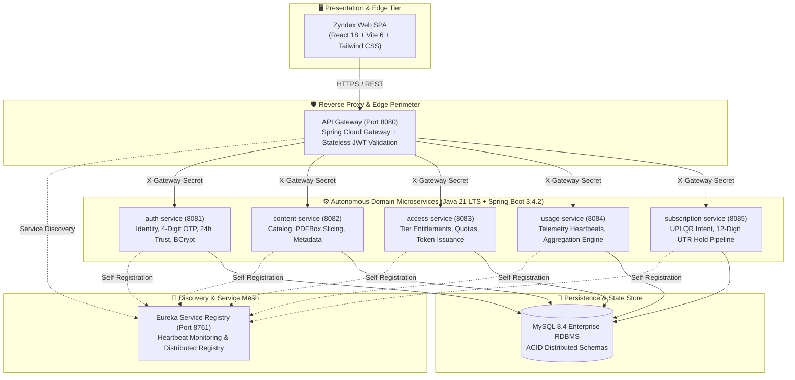
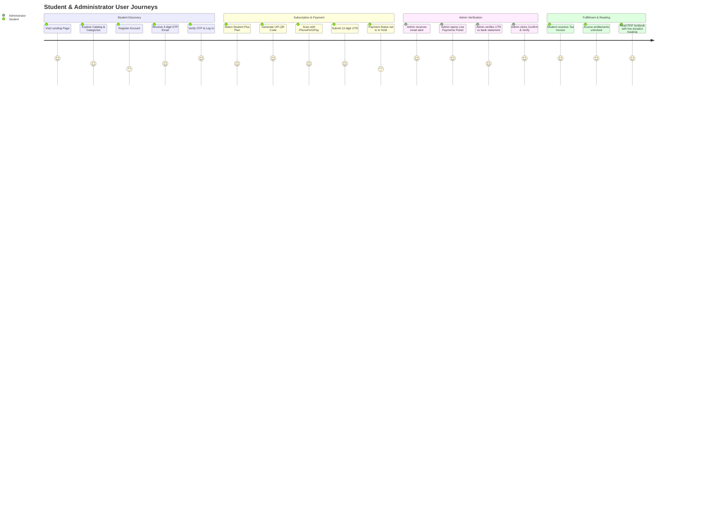
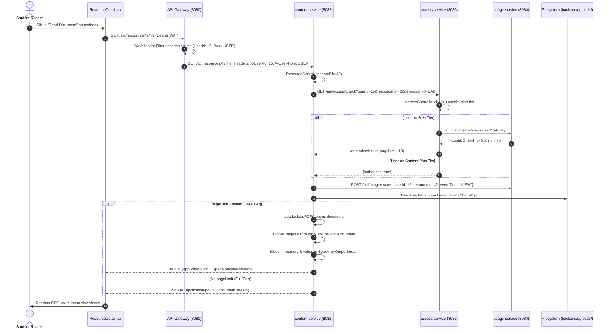
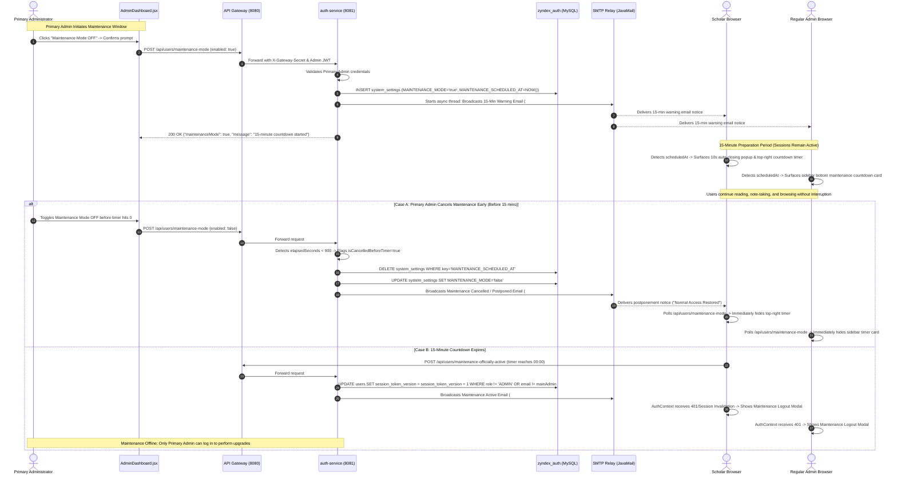
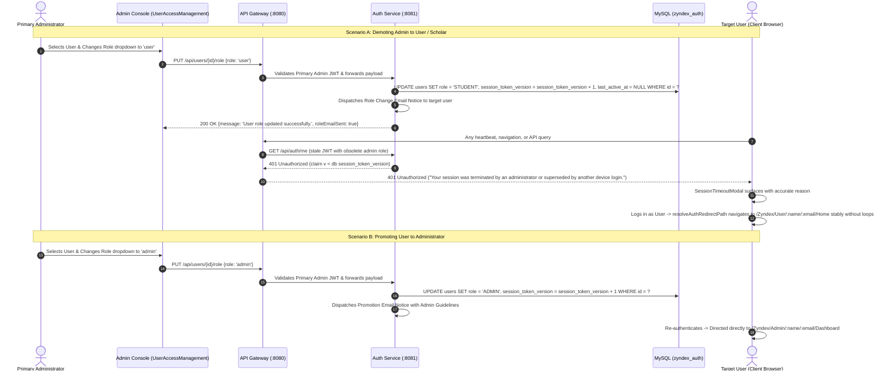
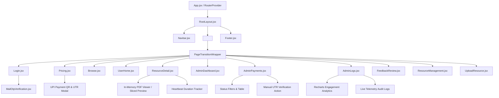
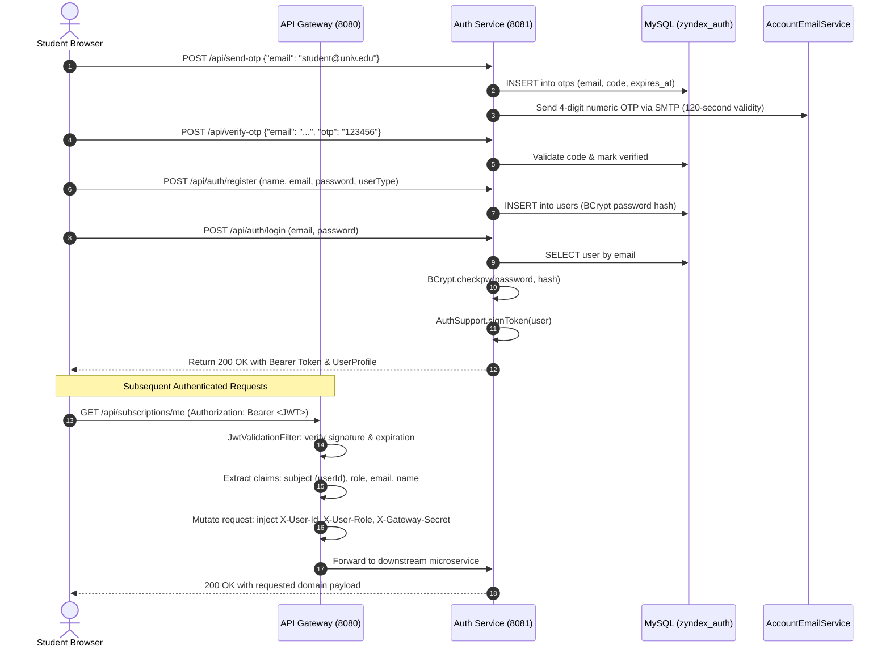
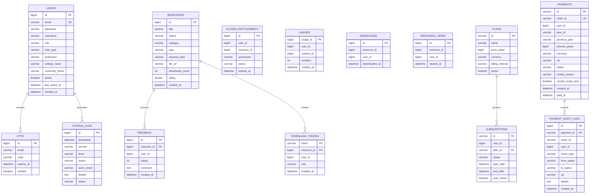
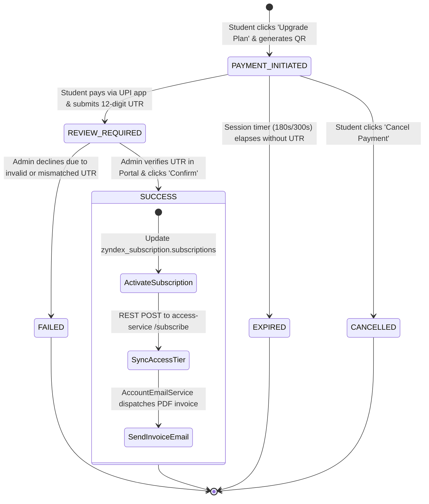

<div align="center">

<a href="https://github.com/BhaanuG/Zyndex-MS">
  
</a>

# ZYNDEX

### Enterprise Distributed Academic Learning & Digital Resource Management Platform

<p align="center">
  <b>Architected, Engineered & Authored Solely by <a href="mailto:Bhaanugali@gmail.com">Bhaanu G (Bhaanu Gali)</a></b><br/>
  <code>Platform Maintainer & Principal Systems Architect</code><br/>
  <a href="mailto:Bhaanugali@gmail.com">Bhaanugali@gmail.com</a> &bull; <a href="mailto:2400030952@kluniversity.in">2400030952@kluniversity.in</a> &bull; <a href="https://github.com/BhaanuG/Zyndex-MS">GitHub Repository</a>
</p>

---

<p align="center">
  <a href="#core-architectural-highlights"></a>
  <a href="#backend-runtime-specifications"></a>
  <a href="#backend-runtime-specifications"></a>
  <a href="#backend-runtime-specifications"></a>
  <a href="#frontend-runtime-specifications"></a>
  <a href="#frontend-runtime-specifications"></a>
  <a href="#database-runtime-specifications"></a>
</p>

<p align="center">
  <a href="LICENSE"></a>
  <a href="SECURITY.md"></a>
  <a href="ACCESSIBILITY.md"></a>
  
  
</p>

<p align="center">
  <a href="#system-architecture--microservices-topology"><b>System Topology</b></a> &bull;
  <a href="#core-architectural-highlights"><b>Architectural Highlights</b></a> &bull;
  <a href="#microservice-registry-and-port-allocation"><b>Service Ports</b></a> &bull;
  <a href="#10-comprehensive-rest-api-reference"><b>REST API Documentation</b></a> &bull;
  <a href="#pin-to-pin-local-cluster-execution"><b>Cluster Quickstart</b></a> &bull;
  <a href="#17-quantitative-codebase-statistics--metrics"><b>Quantitative Metrics</b></a>
</p>

</div>

---

### Executive Architectural Abstract

**Zyndex** is a production-grade, distributed academic learning and digital resource management platform designed for universities, campus libraries, research labs, and academic consortia. The platform eliminates content redistribution risks and resolves fragmented student entitlements through:

- **Strict Cryptographic Perimeter**: Dynamic 4-digit TLS-relayed OTP authentication, multi-device session management with Instagram-style active session monitoring, 24-hour trusted device recognition with daily midnight IST reset, single-session token version enforcement (`session_token_version`), and stateless HMAC-SHA256 JWT access tokens.
- **Zero-Leakage In-Memory PDF Slicing**: Proprietary academic documents are sliced on-the-fly in heap memory via Apache PDFBox for unverified and evaluation tiers, preventing client-side retrieval of complete files.
- **Real-Time Telemetry Engine**: Continuous 15-second client heartbeat aggregation that accurately measures active reading duration, total unique readers, and concurrent live sessions.
- **Dedicated UPI Checkout & Instant Reconciliation**: Dedicated multi-segment checkout route (`/Zyndex/User/:name/:email/Profile/Billing/:amount/Payment/:orderId/UTR/*`) featuring real-time analog clock hands with digital countdown (5-minute QR window, 10-minute UTR window), live UPI payment intent generation, bank UTR hold verification, browser-authenticated invoice viewer (`/Zyndex/Invoice/:id`), and administrative reconciliation portal.

---

### Engineering & Systems Matrix

| Architecture Dimension | Technical Implementation | Operational SLA / Characteristic |
| :--- | :--- | :--- |
| **System Model** | Poly-Service Distributed Microservices | Zero shared memory; independent process isolation |
| **Edge Gateway** | Spring Cloud Gateway on Netty (Reactive Non-Blocking I/O) | Sub-50ms reverse-proxy routing; global CORS & rate limiting |
| **Service Registry** | Netflix Eureka Service Discovery | Real-time 30s heartbeat leasing & client-side load balancing |
| **Perimeter Security** | `X-Gateway-Secret` Internal Header Validation | Downstream services block direct external access |
| **Identity & Hashing** | Spring Security 6 + BCrypt (Adaptive Salt Factor 10) | Brute-force resistant credential storage |
| **Persistence Layer** | MySQL 8.4 LTS with InnoDB Engine | ACID transaction boundaries with relational referential integrity |
| **Frontend Framework** | React 18.3.1 SPA via Vite 6 + Tailwind CSS 3.4 | Dynamic code-split bundle; client-side routing fallback |
| **Sole Authority** | **Bhaanu G (Bhaanu Gali)** | All system designs, IP, and platform rights reserved |

---

## System Architecture & Microservices Topology

[](https://gitdiagram.com/bhaanug/zyndex-ms?utm_source=readme&utm_medium=picture)

<br/>



---

## 💎 Production Benchmarks & Architectural Highlights

| Enterprise Dimension | Architectural Implementation | Engineering Benefit |
| :--- | :--- | :--- |
| **Edge Routing & Perimeter** | Spring Cloud Gateway on Netty (Non-Blocking Reactive I/O) | High throughput with sub-50ms round-trip latency across API routes. |
| **Stateless Authentication** | HMAC-SHA256 Signed JWTs with Claims-based RBAC | Horizontal scalability without shared session state bottlenecks. |
| **Two-Factor OTP Relay** | `java.security.SecureRandom` + TLS SMTP Mail Dispatch | Brute-force protected 4-digit numeric verification with 2-minute TTL. |
| **Zero-Leakage PDF Slicing** | Dynamic in-memory Apache PDFBox Bytecode Stream | Non-paying clients never receive proprietary document streams. |
| **Real-Time Telemetry** | 15-Second Ping Heartbeat Aggregation Engine | Real-time tracking of active readers and session lengths. |
| **UPI Reconciliation Pipeline** | Direct UPI Deep Links + 12-Digit Bank UTR Hold Verification | Frictionless Indian payments without card credentials. |
| **Accessibility Compliance** | WCAG 2.1 Level AA + Section 508 Standards | Fully keyboard navigatable with 4.5:1 contrast ratios and ARIA tags. |

---

## 📑 Executive Table of Contents
1. [Platform Overview & Mission Architecture](#1-project-identity--overview)
2. [Domain Problem Statement & Solution Matrix](#2-what-is-zyndex-concept-domain--user-journeys)
3. [Function-by-Function Source Code Inventory](#3-function-by-function-source-code-inventory)
4. [Exact End-to-End Execution Flow Traces](#4-exact-end-to-end-execution-flow-traces)
5. [Business Logic & Rules Knowledge Base](#5-business-logic--rules-knowledge-base)
6. [Complete Codebase Directory & File Reference](#6-complete-codebase-directory--file-reference)
7. [Complete Microservices System Architecture](#7-complete-microservices-system-architecture)
8. [Frontend Architecture & Page-by-Page Reference](#8-frontend-architecture--page-by-page-reference)
9. [Security, Authentication & JWT Traceability](#9-security-authentication--jwt-traceability)
10. [Comprehensive REST API Reference](#10-comprehensive-rest-api-reference)
11. [Database Architecture, Schemas & Mermaid ER Diagrams](#11-database-architecture-schemas--mermaid-er-diagrams)
12. [Payment Gateway & Subscription Architecture](#12-payment-gateway--subscription-architecture)
13. [Pin-to-Pin Practical Debugging Handbook](#13-pin-to-pin-practical-debugging-handbook)
14. [Installation, Setup & Local Execution Guide](#14-installation-setup--local-execution-guide)
15. [Testing Documentation & Verification Suites](#15-testing-documentation--verification-suites)
16. [Deployment, Production Readiness & Known Risks](#16-deployment-production-readiness--known-risks)
17. [Quantitative Codebase Statistics & Metrics](#17-quantitative-codebase-statistics--metrics)
18. [Glossary of Technical Terminology](#18-glossary-of-technical-terminology)
19. [Developer Quick Navigation Index](#19-developer-quick-navigation-index)

---

## 1. Project Identity & Overview

**Zyndex** is a production-grade, distributed digital library and academic resource repository. Designed for higher-education institutions, university campuses, and research organizations, Zyndex provides an end-to-end ecosystem connecting students, researchers, faculty, and administrators with textbooks, academic journals, syllabus guides, research papers, and lecture materials under strict digital access governance, multi-tiered subscription memberships, automated email notifications, and real-time telemetry analytics.

### 1.1 The Problem Zyndex Solves
Academic institutions and independent publishers face severe digital content distribution challenges:
- **Uncontrolled Redistribution & Copyright Infringement**: Universities struggle to distribute copyrighted textbooks and reference materials safely without risk of unauthorized downloading and redistribution.
- **Disconnected Identity & Entitlements**: Traditional learning systems maintain user accounts separately from tier subscriptions, leading to fractured student access and complex entitlement enforcement.
- **Absence of Verifiable Telemetry**: Academic leadership lacks granular data regarding which textbooks students actively read, how many minutes are spent per subject, and whether students meet reading quotas.
- **Payment Verification Complexities in Emerging Markets**: Traditional recurring card billing frequently fails in India due to e-mandate banking regulations. Zyndex solves this through direct **UPI intent and QR code generation**, 12-digit UTR reference submission, and an administrative verification portal.

### 1.2 Quick Project Reference Table

| Attribute | Implementation Details |
| :--- | :--- |
| **Project Name** | **Zyndex** |
| **Primary Domain** | Enterprise Academic Resource Management & Tiered Content Delivery |
| **Architecture** | Poly-Service Microservices orchestrated via Netflix Eureka and Spring Cloud Gateway |
| **Backend Stack** | Java 21 LTS, Spring Boot 3.4.2, Spring Cloud 2024.0.0, Spring Security 6, JJWT 0.11.5, Spring JDBC |
| **Frontend Stack** | Pure React 18.3.1 (JavaScript + JSX), Vite 6.0.5, Tailwind CSS 3.4.17, Recharts 2.15.0, Lucide Icons |
| **Database Architecture** | MySQL 8.x with 5 isolated schemas (`zyndex_auth`, `zyndex_content`, `zyndex_access`, `zyndex_usage`, `zyndex_subscription`) |
| **Authentication & Tokens**| JWT (HMAC-SHA256, 2h 30m session timeout, prompt at 2h), 4-digit numeric OTPs via SMTP, 24h trusted device bypass, BCrypt password hashing, RBAC |
| **Payment Verification** | Direct UPI QR code generation, 180s/300s session timers, 12-digit UTR submission, 2-minute Verification Hold Processing modal, Admin Review Hold |
| **Community & Compliance**| MIT License, Code of Conduct, Contributing Guide, Security Policy, Accessibility Statement, GitHub Issue & PR Templates |
| **Inter-Service Security**| `X-Gateway-Secret` header validation via `GatewaySecretFilter` across all downstream services |
| **Local Startup** | `npm run dev:all` (orchestrates all 7 Java microservices and the Vite frontend concurrently) |
| **Compilation Status** | **0 Errors, 0 Warnings** across all Maven projects and Vite production bundles |

---

## 2. What is Zyndex? Concept, Domain & User Journeys

### 2.1 Core Business Concepts & Roles

Zyndex models the academic ecosystem around three foundational concepts: **Catalog Resources**, **Access Entitlements**, and **Reading Telemetry**.

1. **Digital Publishing & Catalog Model**:
   - Content is categorized into **Textbooks**, **Academic Journals**, **Research Papers**, **Syllabus Modules**, and **Lecture Notes**.
   - Resources are organized by academic level (`Undergraduate`, `Postgraduate`, `PhD`), department (`Computer Science`, `Electrical Engineering`, etc.), semester, and required tier (`FREE`, `STUDENT_BASIC`, `STUDENT_PLUS`, `RESEARCHER_PRO`).
   - Files are stored on the server filesystem under `backend/uploads/` and streamed securely. PDF files requested by free-tier users are dynamically sliced in-memory via **Apache PDFBox** to prevent access beyond the 10-page preview ceiling.
2. **Subscription & Entitlement Model**:
   - **Free / Demo**: Public documents only, 10-page preview limit, maximum 5 readings per day, online viewing only.
   - **Student Basic (₹99/mo)**: Digital books, academic journals, unlimited online reading, personal reading history.
   - **Student Plus (₹199/mo)**: Entire catalog, digital books, journals, research documents, offline browser saving, advanced semantic filtering, engagement metrics.
   - **PhD Scholar / Researcher (₹499/mo)**: Complete research collection, citation exports, download permissions for authorized documents, researcher analytics.
   - **University (₹1,00,000/yr) & Enterprise (₹3 - 5 Lakh/yr)**: Campus-wide SSO access, bulk student seats, institutional reporting, and administrative controls.
3. **Telemetry & Reading Duration**:
   - While a student reads a document, the browser reader executes periodic heartbeats (`POST /api/resources/{id}/track-duration` and `/api/usage/records`).
   - Telemetry data is recorded in `zyndex_usage.usages` and aggregated in real-time, computing active sessions (users active within 15 minutes) and total reading time formatted into hours, minutes, and seconds.

### 2.2 End-to-End User Journeys



---

## 3. Function-by-Function Source Code Inventory

This section provides an exhaustive, class-by-class and method-by-method technical inventory of all application-owned backend controllers, services, security filters, and core utilities across every microservice in Zyndex.

---

### 3.1 Authentication & User Microservice (`auth-service` : 8081)

#### 3.1.1 `AuthController.java`
- **Path**: `auth-service/src/main/java/com/zyndex/auth/AuthController.java`
- **Package**: `com.zyndex.auth`
- **Purpose**: Exposes authentication endpoints including registration, credential verification, JWT issuance, admin signup requests, password resets, and session validation.
- **Dependencies**: `JdbcTemplate jdbc`, `AuthSupport auth`, `AppProperties properties`, `AccountEmailService accountEmailService`.
- **Key Methods**:
  1. `register(@RequestBody Map<String, Object> body)`
     - **Signature**: `Map<String, Object> register(Map<String, Object> body)`
     - **Mapping**: `POST /api/auth/register`
     - **Parameters**: `name`, `email`, `password`, `userType` (or `role`), `collegeName` (optional).
     - **Return**: Map containing `message`, created `user` summary, and default `FREE` tier assignment.
     - **Execution Sequence**:
       1. Validates that `email`, `name`, and `password` are non-blank.
       2. Validates password strength via `auth.validatePasswordStrength(password)` (minimum 8 characters, digit, uppercase, special character).
       3. Queries `zyndex_auth.users` to ensure email is not already registered.
       4. Hashes password using `auth.passwordEncoder.encode(password)` (BCrypt).
       5. Inserts user into `users` table with `status = 'ACTIVE'`, `subscription_plan = 'FREE'`.
       6. Asynchronously sends welcome email via `accountEmailService.sendSignupConfirmationEmail`.
     - **Exceptions**: `ApiException(HttpStatus.BAD_REQUEST)` if fields are missing or email exists.
     - **Database Operations**: `SELECT id FROM users WHERE LOWER(email) = ?`, `INSERT INTO users ...`.
  2. `login(HttpServletRequest request, @RequestBody Map<String, Object> body)`
     - **Signature**: `Map<String, Object> login(HttpServletRequest, Map<String, Object>)`
     - **Mapping**: `POST /api/auth/login`
     - **Parameters**: `email`, `password`, `role` (default `"user"`), optional `deviceToken`, `deviceName`, `browser`, `os`, `isTrusted`.
     - **Return**: Map containing `token` (7-day signed JWT) and sanitized `user` object.
     - **Execution Sequence**:
       1. Queries `users` by lowercase email. Throws 401 if not found.
       2. Verifies account status is `ACTIVE` and `is_terminated == false` (throws 403 if terminated or suspended).
       3. Checks role authorization: if `role="admin"` requested, user must possess `role="ADMIN"`.
       4. Evaluates password with `auth.passwordEncoder.matches(rawPassword, storedHash)`. Throws 401 on mismatch.
       5. Increments `session_token_version = session_token_version + 1` in `users` table to invalidate older active sessions across other devices.
       6. Extracts real client IP via `AuthSupport.getClientIp(request)` (reading `X-Forwarded-For` / remote network address).
       7. If `deviceToken` is supplied, registers/updates the device session in `trusted_devices` table with `is_trusted` flag and expiration timestamp (midnight IST if trusted, 30 days retention for active session tracking).
       8. Generates HMAC-SHA256 JWT via `auth.signToken(user)` containing updated `session_token_version`.
     - **Exceptions**: `ApiException(HttpStatus.UNAUTHORIZED)`, `ApiException(HttpStatus.FORBIDDEN)`.
  3. `checkLogin(HttpServletRequest request, @RequestBody Map<String, Object> body)`
     - **Signature**: `Map<String, Object> checkLogin(HttpServletRequest, Map<String, Object>)`
     - **Mapping**: `POST /api/auth/check-login`
     - **Purpose**: Pre-validates user credentials during multi-step authenticator screens without issuing an active session token.
  4. `checkTrustedDevice(@RequestBody Map<String, Object> body)`
     - **Mapping**: `POST /api/auth/check-trusted-device`
     - **Purpose**: Verifies whether an incoming `deviceToken` is actively recognized and flagged with `is_trusted = true` (within the current day prior to midnight IST) to safely bypass email OTP during login.
  5. `trustDevice(HttpServletRequest request, @RequestBody Map<String, Object> body)`
     - **Mapping**: `POST /api/auth/trust-device`
     - **Purpose**: Stores or renews a device session in `trusted_devices` with device token, device name, browser, OS, real client IP, and trust status.
  6. `untrustDevice(@RequestBody Map<String, Object> body)`
     - **Mapping**: `POST /api/auth/untrust-device`
     - **Purpose**: Sets `is_trusted = false` for the designated device token without wiping its login history from user audit logs.
  7. `adminRequest(@RequestBody Map<String, Object> body)`
     - **Signature**: `Map<String, Object> adminRequest(Map<String, Object> body)`
     - **Mapping**: `POST /api/auth/admin-request`
     - **Purpose**: Allows institutional leaders to submit an administrative access request stored in `admin_requests` table with status `PENDING`.
  8. `decideAdminRequest(HttpServletRequest request, @PathVariable long id, @RequestBody Map<String, Object> body)`
     - **Signature**: `Map<String, Object> decideAdminRequest(HttpServletRequest, long, Map<String, Object>)`
     - **Mapping**: `PUT /api/auth/admin-requests/{id}/decision`
     - **Purpose**: Approves (`APPROVED`) or rejects (`REJECTED`) admin requests. If approved, promotes target user role to `ADMIN`.

#### 3.1.2 `OtpController.java`
- **Path**: `auth-service/src/main/java/com/zyndex/auth/OtpController.java`
- **Package**: `com.zyndex.auth`
- **Purpose**: Generates, stores, throttles, and verifies 4-digit numeric One-Time Passwords (OTPs) for registration, password reset, and sensitive logins.
- **Dependencies**: `JavaMailSender mailSender`, `AppProperties properties`, `AuthSupport auth`.
- **In-Memory Store**: `ConcurrentHashMap<String, OtpRecord> otps` where key is `email:role` and record holds `otp`, `expiresAt` (Instant), and `attempts` count.
- **Key Methods**:
  1. `send(@RequestBody Map<String, Object> body)`
     - **Signature**: `Map<String, Object> send(Map<String, Object> body)`
     - **Mapping**: `POST /api/send-otp`
     - **Parameters**: `email`, `role` (`"user"` or `"admin"`), `purpose` (`"REGISTRATION"`, `"PASSWORD_RESET"`, etc.).
     - **Code Logic**:
       - Generates 4-digit code: `String.valueOf(1000 + RANDOM.nextInt(9000))`.
       - Stores record with 120-second TTL (`OTP_TTL_SECONDS = 120`) and 0 attempts.
       - Dispatches HTML formatted email using `MimeMessageHelper` via configured SMTP relay.
     - **Return**: `{"message": "Verification code sent."}`.
  2. `verify(@RequestBody Map<String, Object> body)`
     - **Signature**: `Map<String, Object> verify(Map<String, Object> body)`
     - **Mapping**: `POST /api/verify-otp`
     - **Parameters**: `email`, `otp`, `role`.
     - **Validation**:
       - Rejects if record missing or expired (`record.expiresAt().isBefore(Instant.now())`).
       - Enforces rate limiting: increments `attempts`. If `attempts > 5`, purges record and throws 429 Too Many Requests.
       - Checks match with `record.otp().equals(candidateOtp)`. On match, removes record from map and returns 200 OK.

#### 3.1.3 `UserController.java`
- **Path**: `auth-service/src/main/java/com/zyndex/auth/UserController.java`
- **Package**: `com.zyndex.auth`
- **Purpose**: User profile management, administrative user CRUD, status updates, multi-device session tracking, device revocation, and internal plan upgrade email dispatches.
- **Key Methods**:
  1. `profile(HttpServletRequest request, @PathVariable("userId") String userId)`: Returns user profile including name, email, department, college, and active subscription plan.
  2. `updateProfile(HttpServletRequest request, @RequestBody Map<String, Object> body)`: Updates name, department, phone, college, and avatar URL.
  3. `getActiveSessions(HttpServletRequest request)`:
     - **Mapping**: `GET /api/users/sessions`
     - **Purpose**: Powers the Instagram-style **Security & Devices** panel.
     - **Logic**: Retrieves active and trusted devices from `trusted_devices` table for the current user ID / email, extracts caller's real client IP (`AuthSupport.getClientIp`), current `session_token_version`, and device trust metadata.
  4. `revokeOtherSessions(HttpServletRequest request, @RequestBody Map<String, Object> body)`:
     - **Mapping**: `POST /api/users/sessions/revoke-others`
     - **Purpose**: Increments user's `session_token_version` to invalidate all other JWT sessions across browsers/devices and purges other device registrations from `trusted_devices`. Re-issues a fresh JWT for the active browser.
  5. `revokeDeviceSession(HttpServletRequest request, @PathVariable("deviceId") long deviceId)`:
     - **Mapping**: `DELETE /api/users/sessions/devices/{deviceId}`
     - **Purpose**: Revokes and purges a specific device login record by ID, logging the action in `system_logs`.
  6. `deleteAccount(HttpServletRequest request, @RequestBody Map<String, Object> body)`:
     - **Mapping**: `DELETE /api/users/profile`
     - **Purpose**: Self-service permanent account deletion protected by 4-digit OTP verification and confirmation challenge phrase. Dispatches farewell and admin audit emails.
  7. `planUpgradeEmail(HttpServletRequest request, @RequestBody Map<String, Object> body)`: Internal inter-service endpoint called by `subscription-service` to dispatch celebratory email when admin confirms UPI payment or subscription is upgraded.

#### 3.1.4 `LogController.java`
- **Path**: `auth-service/src/main/java/com/zyndex/auth/LogController.java`
- **Package**: `com.zyndex.auth`
- **Purpose**: System audit logging engine.
- **Key Methods**:
  1. `listLogs(HttpServletRequest request, @RequestParam Map<String, String> query)`: Retrieves paginated system logs from `system_logs` table with dynamic filtering by `service`, `level` (`ERROR`, `WARN`, `INFO`), and `search` pattern. Returns statistical level counts.
  2. `createLog(HttpServletRequest request, @RequestBody Map<String, Object> body)`: Inserts an audit log entry with IP address, actor email, service name, action, and JSON details.

---

### 3.2 Content & Catalog Microservice (`content-service` : 8082)

#### 3.2.1 `ResourceController.java`
- **Path**: `content-service/src/main/java/com/zyndex/content/ResourceController.java`
- **Package**: `com.zyndex.content`
- **Purpose**: Manages educational resources, catalog search, file uploads, PDF streaming, dynamic in-memory preview page slicing via Apache PDFBox, and reading duration tracking.
- **Dependencies**: `JdbcTemplate jdbc`, `AppProperties properties`, `RestTemplate restTemplate`, `SqlSupport sql`.
- **Key Methods**:
  1. `all(@RequestParam Map<String, String> query)` & `search(@RequestParam Map<String, String> query)`
     - **Mapping**: `GET /api/resources`, `GET /api/resources/search`
     - **Logic**: Executes paginated SQL query against `resources` table with case-insensitive filtering on `category`, `type`, and keyword matching across `title`, `description`, and `author`.
  2. `upload(HttpServletRequest request, @RequestParam Map<String, String> form, @RequestParam(value = "file", required = false) MultipartFile file)`
     - **Mapping**: `POST /api/resources`
     - **Security**: Requires `ADMIN` role via `requireAdmin(request)`.
     - **File Storage**: Saves file to disk via `storeFile(file)` under `backend/uploads/<UUID>.<ext>`.
     - **Database**: Inserts record into `resources` with `required_plan` (`FREE`, `STUDENT_BASIC`, `STUDENT_PLUS`, `RESEARCHER_PRO`).
  3. `serveFile(@PathVariable("id") long id, @RequestParam(value = "token", required = false) String token, HttpServletRequest request)`
     - **Mapping**: `GET /api/resources/{id}/file`
     - **Purpose**: Securely streams document files to the reader.
     - **Execution Flow**:
       1. Validates user via `X-User-Id` header or short-lived download token from `download_tokens` table (60s TTL).
       2. Fetches resource row; resolves file path via `resolveStoredFile(fileUrl)`.
       3. Invokes `checkAccessDetails(userId, id, "READ", role, category, type)` by calling `access-service/api/access/check`.
       4. Throws 403 Forbidden if not authorized.
       5. Logs `VIEW` usage event to `usage-service`.
       6. **Apache PDFBox In-Memory Slicing**:
          - If `accessDetails` contains `pageLimit` (e.g. 10 pages for Free-tier users) and file is a PDF:
          - Loads document via `org.apache.pdfbox.Loader.loadPDF(file.toFile())`.
          - If total pages > `pageLimit`, creates a new `PDDocument`, clones pages `0` to `pageLimit - 1`, saves to `ByteArrayOutputStream`, and returns the sliced byte array as `application/pdf`.
          - Fully prevents unauthorized access to remaining textbook pages at the binary stream level.
  4. `trackDuration(HttpServletRequest request, @PathVariable("id") long id, @RequestBody Map<String, Object> body)`
     - **Mapping**: `POST /api/resources/{id}/track-duration`
     - **Purpose**: Receives client reading heartbeat (e.g. 15 or 30 seconds) and forwards duration to `usage-service/api/usage/records`.

#### 3.2.2 `UserContentController.java`
- **Path**: `content-service/src/main/java/com/zyndex/content/UserContentController.java`
- **Methods**:
  - `favorites(HttpServletRequest request, @RequestParam Map<String, String> query)`: Paginated user favorites from `favorites` table.
  - `addFavorite(HttpServletRequest request, @PathVariable("resourceId") long resourceId)`: Adds bookmark.
  - `removeFavorite(HttpServletRequest request, @PathVariable("resourceId") long resourceId)`: Deletes bookmark.
  - `recentViews(HttpServletRequest request, ...)`: Fetches student reading history.

#### 3.2.3 `FeedbackController.java`
- **Path**: `content-service/src/main/java/com/zyndex/content/FeedbackController.java`
- **Methods**:
  - `submit(HttpServletRequest, @RequestBody Map<String, Object> body)`: Submits platform feedback.
  - `contact(@RequestBody Map<String, Object> body)`: Submits help inquiries and dispatches email via `ContactEmailService`.
  - `all(HttpServletRequest, @RequestParam Map<String, String> query)`: Administrative feedback review portal.

---

### 3.3 Access & Entitlements Microservice (`access-service` : 8083)

#### 3.3.1 `AccessController.java`
- **Path**: `access-service/src/main/java/com/zyndex/access/AccessController.java`
- **Package**: `com.zyndex.access`
- **Purpose**: Authoritative decision point for resource access, subscription gating, daily free-tier reading limits, and download permissions.
- **Dependencies**: `JdbcTemplate jdbc`, `RestTemplate restTemplate`.
- **Key Methods**:
  1. `check(Long userId, Long resourceId, String permission, String role, String category, String type, String requiredPlan)`
     - **Mapping**: `GET /api/access/check`
     - **Decision Hierarchy**:
       1. If `role="admin"`: Returns `{"authorized": true}` immediately (full admin bypass).
       2. Direct Entitlement Check: Queries `access_entitlements` for active record matching `user_id`, `resource_id`, and permission.
       3. Global Plan Check: Queries user's active plan entitlement (`resource_id IS NULL`).
       4. Tier Comparison: Compares `userTier` against `reqTier` (FREE=0, STUDENT_BASIC=1, STUDENT_PLUS=2, RESEARCHER=3, UNIVERSITY=4, ENTERPRISE=5). If `userTier < reqTier`, returns `authorized: false`.
       5. Download Gating: If `permission="DOWNLOAD"` and `userTier < 3` (Researcher Pro), returns `authorized: false`.
       6. Free Tier Daily Limit Check:
          - If `userTier == 0` and content is public/demo:
          - Queries `usage-service/api/usage/views/user/{userId}/today` to count distinct documents viewed today.
          - If count >= `FREE_DAILY_READ_LIMIT` (default 5) and resource not already viewed today, returns `authorized: false`.
          - If permitted, returns `{"authorized": true, "pageLimit": 10}` to enforce PDF slicing.
  2. `subscribe(HttpServletRequest request, @RequestBody Map<String, Object> body)`
     - **Mapping**: `POST /api/access/subscribe`
     - **Security**: Restricted to internal calls containing `X-Internal-Service: subscription-service`.
     - **Logic**: Revokes prior plan entitlements in `access_entitlements` and grants new active entitlement with expiration calculated as `NOW() + INTERVAL durationDays DAY`.

---

### 3.4 Telemetry & Usage Microservice (`usage-service` : 8084)

#### 3.4.1 `UsageController.java`
- **Path**: `usage-service/src/main/java/com/zyndex/usage/UsageController.java`
- **Package**: `com.zyndex.usage`
- **Purpose**: Collects telemetry events, reading duration heartbeats, computes real-time active sessions, and outputs live reading audit logs.
- **Key Methods**:
  1. `logDuration(@RequestBody Map<String, Object> body)`
     - **Mapping**: `POST /api/usage/records`
     - **Parameters**: `userId`, `contentId` (or `resourceId`), `duration` (in seconds or minutes).
     - **Logic**: Inserts record into `zyndex_usage.usages` table with timestamp.
  2. `getEngagementAnalytics()`
     - **Mapping**: `GET /api/usage/engagement/analytics`
     - **Purpose**: Feeds admin analytics dashboard.
     - **Metrics Calculated**:
       - `totalReadingMinutes`: Sum of `duration` across `usages`.
       - `totalSessions`: Count of all reading sessions.
       - `activeSessionsNow`: Users whose `last_active_at` in `zyndex_auth.users` was within the last 15 minutes (`NOW() - INTERVAL 15 MINUTE`).
       - `trendData`: Hourly aggregated reading minutes and unique readers over past 24 hours.
  3. `getLiveReadingHistory(@RequestParam int page, @RequestParam int size)`
     - **Mapping**: `GET /api/usage/history/live`
     - **Purpose**: Powers live system logs in Admin portal.
     - **Logic**: Multi-table cross-schema join (`zyndex_usage.usages` joined with `zyndex_content.resources`, `zyndex_auth.users`, and `zyndex_access.access`) returning user name, user email, document title, category, reading duration, and timestamp.

---

### 3.5 Subscription & Payment Microservice (`subscription-service` : 8085)

#### 3.5.1 `SubscriptionController.java`
- **Path**: `subscription-service/src/main/java/com/zyndex/subscription/SubscriptionController.java`
- **Package**: `com.zyndex.subscription`
- **Purpose**: Plan catalog retrieval, checkout session creation, UTR submission, payment status polling, user subscription cancellation, and admin payment verification.
- **Key Methods**:
  1. `getPlans()`: `GET /api/subscriptions/plans` — Returns active subscription plans ordered by price.
  2. `createCheckout(HttpServletRequest request, @RequestBody Map<String, Object> body)`: `POST /api/subscriptions/checkout` — Delegates to `paymentService.createCheckoutSession`.
  3. `submitUtr(HttpServletRequest request, @PathVariable String paymentId, @RequestBody Map<String, Object> body)`: `POST /api/subscriptions/payment/{paymentId}/submit-utr` — Submits 12-digit UTR reference number for manual admin review.
  4. `getAdminPayments(HttpServletRequest request)`: `GET /api/subscriptions/admin/payments` — Admin portal endpoint to view all transactions with user names and emails.
  5. `verifyAdminPayment(HttpServletRequest request, @PathVariable String paymentId, @RequestBody Map<String, Object> body)`: `POST /api/subscriptions/admin/payments/{paymentId}/verify` — Admin approves (`CONFIRM`) or declines (`DECLINE`) pending payment.

#### 3.5.2 `PaymentService.java`
- **Path**: `subscription-service/src/main/java/com/zyndex/subscription/PaymentService.java`
- **Package**: `com.zyndex.subscription`
- **Purpose**: Core payment processing, UPI intent formatting, QR code generation, UTR hold state transitions, audit logging, admin verification, and subscription entitlement synchronization.
- **Key Methods**:
  1. `createCheckoutSession(Long userId, String requestedPlanId, String requestedPaymentMethod)`
     - Validates plan exists and is active.
     - Inserts record into `payments` with status `PAYMENT_INITIATED`, generates `order_id` (`ORD_...`).
     - Formats direct UPI URI (`upi://pay?pa=918897337687@waaxis&pn=Zyndex%20Digital&am=...`).
     - Constructs QR code URL using `api.qrserver.com`.
  2. `submitUtrForReview(Long userId, String paymentId, String utrNumber)`
     - Validates non-blank UTR string.
     - Updates payment status to `REVIEW_REQUIRED` and sets `review_reason = 'User submitted UTR for manual verification. Subscription on hold.'`.
     - Logs audit entry `UTR_SUBMITTED_HOLD` in `payment_audit_logs`.
     - Calls `sendAdminHoldNotificationEmail` to notify `Bhaanugali@gmail.com` and `Bhaanugali99sai@gmail.com` with complete user, order, and UTR details.
  3. `verifyAdminPayment(String paymentId, String action, String adminUtr, String note)`
     - When `action="CONFIRM"`:
       - Invokes `activateSuccessfulSubscription`.
       - Updates payment status to `SUCCESS`.
       - Revokes old subscription in `subscriptions` and inserts new active subscription.
       - Calls `access-service/api/access/subscribe` via `RestTemplate` to elevate reading access.
       - Dispatches plan upgrade notification email via `auth-service`.
       - Sends multi-page GST tax invoice receipt email to student.
     - When `action="DECLINE"`:
       - Updates payment status to `FAILED` with `failure_reason`.
  4. `getAllPaymentsForAdmin()`
     - Retrieves all payment records.
     - Enriches each record with user name and user email by querying `zyndex_auth.users` directly or calling `auth-service/api/users/{id}/profile`.

#### 3.5.3 `PaymentWebhookController.java`
- **Path**: `subscription-service/src/main/java/com/zyndex/subscription/PaymentWebhookController.java`
- **Purpose**: Ingests automated payment gateway webhook callbacks, validating HMAC-SHA256 signatures, timestamps, and idempotency delivery IDs.

---

### 3.6 API Gateway & Service Discovery

#### 3.6.1 `JwtValidationFilter.java`
- **Path**: `api-gateway/src/main/java/com/zyndex/gateway/JwtValidationFilter.java`
- **Package**: `com.zyndex.gateway`
- **Type**: Spring Cloud Gateway GlobalFilter (`Ordered.HIGHEST_PRECEDENCE + 10`).
- **Logic**:
  1. Whitelists public paths (`/api/auth/login`, `/api/auth/register`, `/api/send-otp`, etc.).
  2. Extracts `Authorization: Bearer <token>`.
  3. Validates HMAC-SHA256 signature and expiration using JJWT.
  4. Strips inbound client spoofed headers (`X-User-Id`, `X-User-Role`, `X-User-Email`).
  5. Injects verified claims as request headers: `X-User-Id`, `X-User-Role`, `X-User-Email`.
  6. Injects `X-Gateway-Secret` header to authorize downstream service communication.

#### 3.6.2 `GatewaySecretFilter.java` (Present in all 5 downstream services)
- **Purpose**: Intercepts all incoming HTTP servlet requests. Compares `X-Gateway-Secret` header with configured `zyndex.gateway-secret`. Rejects direct port calls with HTTP 403 Forbidden.

---

## 4. Exact End-to-End Execution Flow Traces

This section traces the full execution path across frontend components, gateway filters, microservices, database operations, and outbound communications for every major workflow in Zyndex.

---

### 4.1 Flow 1: User Registration & OTP Verification

#### Why OTP Verification Is Mandatory Across Zyndex (Security & Integrity Rationale)
Zyndex mandates 4-digit TLS-relayed One-Time Passwords (OTPs) with a strict 120-second TTL and brute-force attempt limits across critical user workflows. The system rationale includes:
1. **Preventing Spam & Phantom Account Enumeration**: Blocks automated bots and scripts from registering disposable or non-existent email addresses, preserving database health and ensuring only authentic students, researchers, and faculty join the platform.
2. **Eliminating Account Takeovers (2FA on Sensitive Operations)**: Every login session, password reset request, and password change authorization requires out-of-band email verification, defeating credential stuffing attacks and leaked-password exploitation.
3. **Institutional & Legal Compliance**: Protects copyrighted academic textbooks, research papers, and proprietary study resources by binding access strictly to verified email owners.
4. **Seamless User Experience**: 4-digit codes minimize typing errors, allow rapid input, and trigger interactive geometric visual feedback upon entry, ensuring security without creating unnecessary user friction.

#### Core OTP Use Cases in Zyndex:
- **Use Case 1: Account Registration & Email Proof**: Pre-verifies the student/educator email inbox before committing user records to `zyndex_auth.users`.
- **Use Case 2: Login 2-Step Authentication (2FA)**: Dispatches a dynamic code when authenticating a new session (bypassable only via an optional 24-hour trusted device token).
- **Use Case 3: Self-Service Password Reset (Forgot Password)**: Validates proof-of-inbox possession before allowing a user to overwrite their BCrypt password hash.
- **Use Case 4: In-Session Password Change Authorization**: Requires step-up OTP verification when a logged-in user changes credentials from profile settings.
- **Use Case 5: Real-Time Invalidation & Resend (Anti-Replay)**: Requesting a replacement code immediately destroys the previous OTP in memory to prevent replay vulnerabilities.

```mermaid
sequenceDiagram
sequenceDiagram
    autonumber
    actor Student as Student Browser
    participant UI as Login.jsx / MailOtpVerification.jsx
    participant API as ApiClient (Axios)
    participant GW as API Gateway (8080)
    participant Auth as auth-service (8081)
    participant Mail as SMTP Relay
    participant DB as zyndex_auth (MySQL)

    Student->>UI: Fills registration form & clicks "Send OTP"
    UI->>API: POST /api/send-otp {email, role: "user", purpose: "REGISTRATION"}
    API->>GW: HTTP POST /api/send-otp
    GW->>GW: JwtValidationFilter (matches public whitelist)
    GW->>Auth: Forward with X-Gateway-Secret
    Auth->>Auth: GatewaySecretFilter validates secret
    Auth->>Auth: OtpController.send() generates 4-digit OTP (1000-9999)
    Auth->>Auth: Stores in-memory otps.put(email:user, OtpRecord(otp, TTL=120s))
    Auth->>Mail: Dispatches HTML verification email via JavaMailSender
    Mail-->>Student: Delivers 4-digit OTP code to inbox
    Auth-->>GW: 200 OK {"message": "Verification code sent."}
    GW-->>UI: Displays OTP input modal
    Student->>UI: Enters 4-digit OTP & submits
    UI->>API: POST /api/verify-otp {email, otp, role: "user"}
    API->>GW: HTTP POST /api/verify-otp
    GW->>Auth: Forward request
    Auth->>Auth: OtpController.verify() checks TTL & code match
    Auth-->>GW: 200 OK {"message": "Code verified successfully."}
    UI->>API: POST /api/auth/register {name, email, password, userType: "Student"}
    API->>GW: HTTP POST /api/auth/register
    GW->>Auth: Forward request
    Auth->>Auth: AuthController.register() validates password strength
    Auth->>Auth: Encodes password via BCryptPasswordEncoder
    Auth->>DB: INSERT INTO users (name, email, password, role, subscription_plan)
    DB-->>Auth: Generated user ID
    Auth->>Mail: Dispatches welcome confirmation email
    Auth-->>UI: 200 OK with created user summary
    UI->>Student: Redirects to /Zyndex/User/Log-In with success notification
```

### 4.1.1 Comprehensive Master Table of All Transactional Emails & OTP Services

Across the Zyndex microservices architecture, all transactional emails are rendered with responsive branded HTML templates containing header brand gradients, metadata audit cards, and single-click copy buttons for OTP codes:

| # | Category | Email Service / Type | Source Service & Class | Trigger Occasion | Recipient (`To:`) | Subject Line |
|:---:|:---|:---|:---|:---|:---|:---|
| **1** | **OTP Verification** | **Account Creation OTP** | `auth-service` / `OtpController.java` | Triggered when a new user or admin signs up (pre-checked against database to reject existing accounts). | User/Admin signing up | `Zyndex \| Welcome! Verification Code for Creating Your Account` |
| **2** | **OTP Verification** | **Login Authentication OTP (2FA)** | `auth-service` / `OtpController.java` | Triggered when an authenticated user/admin enters credentials on login. | Registered user email | `Zyndex \| Your Login Authentication Verification Code` |
| **3** | **OTP Verification** | **Password Reset OTP** | `auth-service` / `OtpController.java` | Triggered when a user clicks *"Forgot Password"* and requests a password reset. | Account email | `Zyndex \| Password Reset Verification Code` |
| **4** | **OTP Verification** | **Password Change Authorization OTP** | `auth-service` / `OtpController.java` | Triggered when a logged-in user requests to change password from Profile Settings. | Logged-in user email | `Zyndex \| Password Change Authorization Code` |
| **5** | **OTP Verification** | **Replacement / Resend OTP** | `auth-service` / `OtpController.java` | Triggered when user clicks *"Resend OTP"* (prior code is automatically invalidated). | User waiting on verification | `Zyndex \| Your New Replacement Verification Code (Resent OTP)` |
| **6** | **Account Onboarding** | **Signup Confirmation & Welcome Email** | `auth-service` / `AccountEmailService.java` | Dispatched immediately after account registration and OTP verification succeed. | Newly registered user | `Welcome to Zyndex` |
| **7** | **Contact & Support** | **Admin Contact Enquiry Alert** | `content-service` / `ContactEmailService.java` | When a user/visitor submits the public contact form at `/contact`. | Primary Admin (`Bhaanugali@gmail.com`) | `Zyndex \| New Contact Enquiry from [Name]` |
| **8** | **Contact & Support** | **Contact Submission Receipt** | `content-service` / `ContactEmailService.java` | Auto-reply sent to the user confirming their enquiry was received. | Sender's email | `Zyndex \| We've Received Your Enquiry` |
| **9** | **Payments & Upgrades** | **Plan Upgrade Confirmation** | `auth-service` & `subscription-service` / `AccountEmailService.java` | Sent upon successful plan upgrade containing Order ID, UTR number, exact time, and dates. | Upgraded subscriber | `Zyndex \| Plan Upgrade Confirmation` |
| **10** | **Payments & Upgrades** | **Payment Confirmation Receipt** | `subscription-service` / `PaymentService.java` | Dispatched once payment is recorded and verified in the `payments` table. | Paying customer | `Zyndex Subscription Payment Receipt` |
| **11** | **Payments & Upgrades** | **Subscription Activation Notice** | `auth-service` / `AccountEmailService.java` | Direct notice confirming payment of INR amount and activated lifespan days. | Subscriber email | `Zyndex Subscription Activated - [Plan]` |
| **12** | **Subscription Alerts** | **1-Day Expiry Reminder Alert** | `subscription-service` / `SubscriptionExpiryScheduler.java` | Automated cron scheduler sends reminder 24 hours before paid subscription ends. | Active subscriber | `Zyndex \| Subscription Expiring Soon` |
| **13** | **Subscription Alerts** | **Subscription Expired Notification** | `subscription-service` / `SubscriptionExpiryScheduler.java` | Automated scheduler sends notice when subscription lapses and account reverts to Free. | Expired subscriber | `Zyndex \| Subscription Expired - Reverted to Free Plan` |
| **14** | **Admin Workflow** | **Admin Access Request Alert** | `auth-service` / `AccountEmailService.java` | When an applicant applies for administrator privileges at `/Zyndex/Admin/Sign-Up`. | Primary Admin (`Bhaanugali@gmail.com`) | `Zyndex \| New Admin Access Request` |
| **15** | **Admin Workflow** | **Admin Request Received Receipt** | `auth-service` / `AccountEmailService.java` | Sent to the applicant acknowledging that their admin request is under review. | Admin applicant | `Zyndex \| Admin Access Request Received` |
| **16** | **Admin Workflow** | **Admin Access Request Approved** | `auth-service` / `AccountEmailService.java` | When the super admin clicks "Approve" in the admin management dashboard. | Approved admin | `Zyndex \| Admin Access Request Approved` |
| **17** | **Admin Workflow** | **Admin Access Request Declined** | `auth-service` / `AccountEmailService.java` | When the super admin declines an admin request (includes custom reason note). | Declined applicant | `Zyndex \| Admin Access Request Update` |
| **18** | **Security Alerts** | **Password Changed Confirmation** | `auth-service` / `AccountEmailService.java` | Dispatched immediately after the account password has been successfully updated. | Account owner | `Zyndex \| Password Changed Successfully` |
| **19** | **Feedback & Reviews** | **Feedback Admin Response Email** | `content-service` / `ContactEmailService.java` | Dispatched automatically when an administrator reviews, reacts, or replies to user resource feedback from the Feedback Review admin console. Contains the resource title, star rating, submission date, user review comments, and the administrator's direct response. | User who submitted feedback | `Zyndex \| Response to Your Review on "[Resource Title]"` |
| **20** | **Maintenance Alerts** | **Scheduled Maintenance 15-Minute Warning** | `auth-service` / `AccountEmailService.java` | Broadcast to all users and regular admins the moment the Primary Admin initiates maintenance mode, warning that services will go offline in 15 minutes. | All platform users & admins | `Zyndex System Notice | Scheduled Maintenance in 15 Minutes` |
| **21** | **Maintenance Alerts** | **Maintenance Mode Active Notification** | `auth-service` / `AccountEmailService.java` | Broadcast once the 15-minute countdown finishes and all sessions are terminated, notifying users that Zyndex is officially offline for maintenance. | All platform users & admins | `Zyndex System Notice | Platform Maintenance in Progress` |
| **22** | **Maintenance Alerts** | **Maintenance Completed / Back Online** | `auth-service` / `AccountEmailService.java` | Broadcast when the Primary Admin turns maintenance mode off after an active maintenance session, notifying all users and admins that services are fully restored. | All platform users & admins | `Zyndex System Notice | Platform Maintenance Complete - We're Back Online!` |
| **23** | **Maintenance Alerts** | **Maintenance Postponed / Cancelled Alert** | `auth-service` / `AccountEmailService.java` | Broadcast to all users and regular admins if the Primary Admin turns off maintenance before the 15-minute countdown finishes. Informs users that maintenance was cancelled/postponed due to technical adjustments, the sticky timer is disabled automatically, and normal service continues uninterrupted. | All platform users & admins | `Notice: Scheduled Maintenance Postponed / Cancelled - Normal Access Restored` |
| **24** | **Account Deletion** | **Account Deletion Verification OTP** | `auth-service` / `OtpController.java` | Triggered when a user or regular admin requests permanent self-service account deletion from Profile Settings. | User/Admin initiating deletion | `Zyndex \| Security Verification Code for Account Deletion` |
| **25** | **Account Deletion** | **Account Deletion Farewell Confirmation** | `auth-service` / `AccountEmailService.java` | Dispatched to departing user with full deletion confirmation and empathetic farewell once OTP and 'CONFIRM' challenge pass. | Deleted user email | `Zyndex \| Account Successfully Deleted - We're Sorry to See You Go` |
| **26** | **Account Deletion Audit** | **Platform Owner Account Deletion Alert** | `auth-service` / `AccountEmailService.java` | Instant audit alert sent directly to Primary Platform Administrator (`Bhaanugali@gmail.com`) with departing user's name, email, role, timestamp, and feedback reasons. | Primary Admin (`Bhaanugali@gmail.com`) | `Zyndex Audit \| Account Deleted: [User Name] ([User Email])` |

**Detailed Step Traceability**:
1. **User Action**: Student enters name, email, and password on `src/app/pages/Login.jsx`.
2. **Event Handler**: `handleSendOtp` in `Login.jsx` validates input and calls `sendOtp({ email, role: 'user', purpose: 'REGISTRATION' })`.
3. **API Client**: `src/services/api/authService.js` issues `apiClient.post('/api/send-otp', payload)`.
4. **API Gateway**: `api-gateway/src/main/java/com/zyndex/gateway/JwtValidationFilter.java` inspects path, identifies `/api/send-otp` in `PUBLIC_PATH_PREFIXES`, appends `X-Gateway-Secret`, and routes to `lb://auth-service`.
5. **Security Filter**: `auth-service/.../GatewaySecretFilter.java` checks secret match.
6. **Controller**: `auth-service/.../OtpController.java` executes `send`.
7. **Random Generation**: `String.valueOf(1000 + RANDOM.nextInt(9000))` produces 4-digit code.
8. **In-Memory Cache**: Stored in `ConcurrentHashMap<String, OtpRecord>` with `Instant.now().plusSeconds(120)`.
9. **SMTP Dispatch**: `mailSender.send(mimeMessage)` relays email via configured Gmail credentials.
10. **Client Verification**: Student enters code; `handleVerifyOtp` calls `/api/verify-otp`. `OtpController.verify` validates code, prevents brute force (max 5 attempts), and clears OTP record.
11. **Registration Execution**: `AuthController.register` verifies email uniqueness in `users` table, hashes password using BCrypt (cost factor 10), and inserts user with role `USER` and plan `FREE`.

---

### 4.2 Flow 2: Student Login & JWT Issuance

1. **User Action**: Student enters email and password, clicks **Sign In**.
2. **React Event**: `handleSubmit` in `src/app/pages/Login.jsx` triggers `login(email, password, 'user')` from `AuthContext`.
3. **HTTP Call**: `POST /api/auth/login` with body `{"email": "...", "password": "...", "role": "user"}`.
4. **Gateway**: Matches public route, forwards to `auth-service`.
5. **Backend Processing**:
   - `AuthController.login` queries `SELECT * FROM users WHERE LOWER(email) = ?`.
   - Checks `user.status == 'ACTIVE'`.
   - Validates password via `passwordEncoder.matches(rawPassword, storedHash)`.
   - Updates `last_active_at = NOW()` (critical for real-time telemetry analytics).
   - Generates JWT via `AuthSupport.signToken(user)` using HMAC-SHA256 secret. Claims include `sub`: user ID, `email`, `name`, `role`, and 7-day expiration.
6. **Frontend State**: `AuthContext.jsx` receives token and user object, stores token in `localStorage.setItem('auth_token', token)`, sets `currentUser`, and navigates to `/Zyndex/User/:name/:email/Home`.

---

### 4.3 Flow 3: PDF Document Viewing & Apache PDFBox Slicing



---

### 4.4 Flow 4: Reading Telemetry & Duration Aggregation

1. **Reader Timer**: While reading on `src/app/pages/user/ResourceDetail.jsx`, a `setInterval` timer fires every 30 seconds.
2. **Heartbeat Call**: Client calls `POST /api/resources/{id}/track-duration` with `{"duration": 30}`.
3. **Content Forward**: `ResourceController.trackDuration` delegates to `usage-service/api/usage/records`.
4. **Database Insertion**: `UsageController.logDuration` executes `INSERT INTO zyndex_usage.usages (user_id, content_id, duration) VALUES (15, 42, 30)`.
5. **Real-Time Analytics Query**:
   - In `AdminLogs.jsx`, polling calls `GET /api/usage/engagement/analytics`.
   - `UsageController.getEngagementAnalytics` computes `totalReadingMinutes = SUM(duration)`, `totalSessions = COUNT(*)`, and evaluates `activeSessionsNow` by querying `SELECT COUNT(*) FROM zyndex_auth.users WHERE last_active_at >= NOW() - INTERVAL 15 MINUTE`.
   - Formats elapsed time into clean hours, minutes, and seconds for UI display.

---

### 4.5 Flow 5: Dedicated Multi-Segment Checkout, Live Animated Clock & UTR Reconciliation

```mermaid
sequenceDiagram
    autonumber
    actor User as Student / Subscriber
    participant Pricing as Pricing.jsx
    participant PayPage as PaymentPage.jsx (QR & UTR)
    participant GW as API Gateway (8080)
    participant Sub as subscription-service (8085)
    participant AdminUI as AdminPayments.jsx
    participant Access as access-service (8083)
    participant Auth as auth-service (8081)
    participant Mail as SMTP Relay
    participant DB as zyndex_subscription (MySQL)

    User->>Pricing: Selects Plan & clicks "Select Plan"
    Pricing->>GW: POST /api/subscriptions/checkout {planId: "STUDENT_PLUS"}
    GW->>Sub: Forward request (User ID: 15)
    Sub->>Sub: PaymentService.createCheckoutSession()
    Sub->>DB: INSERT INTO payments (status='PAYMENT_INITIATED', order_id='ORD_...')
    Sub-->>Pricing: Returns {paymentId, orderId, upiIntentUri, qrCodeUrl, amountPaise: 19900}
    Pricing->>User: Navigates to dedicated URL: /Zyndex/User/:name/:email/Profile/Billing/:amount/Payment/:orderId/:::::::::
    User->>PayPage: Displays Zyndex Educational Excellence, live dynamic analog clock hands & 5-minute digital countdown
    User->>User: Scans QR code with PhonePe / GPay / Paytm & transfers amount
    User->>PayPage: Clicks "I Have Paid"
    PayPage->>User: Transitions to UTR route: /.../Payment/:orderId/UTR/::::::::: with 10-minute expiry
    User->>PayPage: Inputs 12-digit UTR reference (e.g., "412345678901") & clicks "Verify Payment"
    PayPage->>GW: POST /api/payments/submit-utr {paymentId, utrNumber: "412345678901"}
    GW->>Sub: Forward request
    Sub->>Sub: PaymentService.submitUtrForReview()
    Sub->>DB: UPDATE payments SET status='REVIEW_REQUIRED', utr='412345678901'
    Sub->>DB: INSERT INTO payment_audit_logs (event='UTR_SUBMITTED_HOLD')
    Sub->>Mail: Dispatches Hold Notification email to Bhaanugali@gmail.com
    Sub-->>PayPage: Returns {status: "REVIEW_REQUIRED"}
    PayPage->>User: Shows Payment Submitted status & redirect to Order Details

    Note over AdminUI,Sub: Administrator Verifies Bank Settlement
    AdminUI->>GW: GET /api/payments/admin/all
    GW->>Sub: Forward request (Role: ADMIN)
    Sub->>DB: SELECT * FROM payments ORDER BY created_at DESC
    Sub->>Auth: Fetches user name & email
    Sub-->>AdminUI: Populates transactions table with color-coded badges
    Note over AdminUI: UTR Submitted -> Admin sees direct Accept & Decline buttons; Cancelled at QR -> Eye info icon only
    alt Admin Confirms Payment
        AdminUI->>GW: POST /api/payments/admin/verify {paymentId, action: "CONFIRM"}
        GW->>Sub: Forward request
        Sub->>Sub: PaymentService.verifyAdminPayment() -> activateSuccessfulSubscription()
        Sub->>DB: UPDATE payments SET status='SUCCESS'
        Sub->>DB: UPDATE subscriptions SET status='REVOKED' WHERE user_id=15
        Sub->>DB: INSERT INTO subscriptions (status='ACTIVE', plan_id='STUDENT_PLUS')
        Sub->>Access: POST /api/access/subscribe {userId: 15, plan: "STUDENT_PLUS", durationDays: 30}
        Sub->>Auth: POST /api/users/internal/plan-upgrade-email
        Auth->>Mail: Dispatches Plan Upgrade Confirmation email with timestamp
        Sub->>Mail: Dispatches multi-page printable GST Tax Invoice
    else Admin Declines Payment
        AdminUI->>AdminUI: Admin clicks Decline, opens modal and enters reason comments
        AdminUI->>GW: POST /api/payments/admin/verify {paymentId, action: "DECLINE", note: "..."}
        Sub->>DB: UPDATE payments SET status='FAILED', failure_reason=note
        Sub->>Mail: Dispatches rejection notice with admin comments to user
    end
```

---

### 4.6 Flow 6: Platform Maintenance Mode Lifecycle (15-Minute Countdown, Automated Termination & Early Cancellation)

#### Why Maintenance Mode Exists & System Rationale
Platform Maintenance Mode is an enterprise safeguard engineered exclusively for the **Primary Platform Administrator** (`Bhaanugali@gmail.com`). Critical infrastructure operations — such as database schema migrations, cross-microservice dependency upgrades, bulk asset indexing, server relocations, and security audits — cannot safely proceed while thousands of students and faculty members are actively submitting form writes, completing UPI checkouts, and streaming PDF files. 

Without maintenance controls, concurrent traffic during upgrades causes data corruption, race conditions in payment state machines, and partial record commits. Maintenance Mode guarantees a controlled, zero-data-loss transition window.

#### What Happens When Maintenance Mode Is Triggered
1. **Initiation by Primary Admin**: The Primary Admin toggles Maintenance Mode ON from `/Zyndex/Admin/.../Dashboard`.
2. **Instant Timestamp Stamping**: `auth-service` stamps `MAINTENANCE_MODE = 'true'` and records the exact start timestamp `MAINTENANCE_SCHEDULED_AT = <ISO_TIMESTAMP>` in `zyndex_auth.system_settings`.
3. **Advance Warning Email Broadcast (Email #20)**: An asynchronous background thread retrieves all registered student, faculty, and regular admin email addresses (excluding the Primary Admin) and dispatches individual advance warning emails:
   - **Subject**: `Zyndex System Notice | Scheduled Maintenance in 15 Minutes`
   - **Body**: Explains that maintenance will begin in 15 minutes, outlines affected services, and advises users to save active research work and download necessary notes.
4. **Active Session Preservation (Zero Immediate Logout)**:
   - Crucially, **no sessions are terminated immediately**.
   - `AuthSupport.isMaintenanceMode()` evaluates `MAINTENANCE_SCHEDULED_AT`; because `elapsedSeconds < 15 * 60`, user authorization tokens remain completely valid. Scholars continue reading and browsing freely during the entire 15-minute preparation period.
5. **Real-Time Visual Countdown Timers**:
   - **For Scholars / Regular Users (`UserLayout.jsx`)**:
     - An animated, high-priority notification popup immediately appears at the **top right corner**: *"Scheduled system maintenance is starting soon. The platform will go to maintenance mode in 15 minutes."*
     - The popup features a 10-second linear progress bar and **automatically closes after 10 seconds** without requiring user clicks.
     - A persistent, pulsing timer badge remains permanently anchored at the **top right corner** beside user navigation controls displaying the live seconds countdown: `Maintenance in: mm:ss`.
   - **For Administrators (`AdminLayout.jsx`)**:
     - A dedicated maintenance card is anchored at the **bottom of the profile navigation sidebar** (directly above Logout).
     - Displays the warning banner, operational impact explanation, and live countdown timer readout: `Time Left: mm:ss`.
6. **Grace Period Expiration & Official Lockout**:
   - When the 15-minute countdown timer reaches `00:00`, client browsers invoke `/api/users/maintenance-officially-active`.
   - `auth-service` increments `session_token_version` globally for all users except the Primary Admin and clears `last_active_at`, immediately invalidating all outstanding JWT sessions across devices.
   - All scholar and regular admin sessions are terminated. An involuntary logout modal is displayed with the explanation: *"The platform is currently in maintenance mode. We are sorry for the inconvenience, please check back shortly."*
   - **Maintenance Active Email Broadcast (Email #21)** is dispatched to all platform members informing them that maintenance is officially in progress.
   - On the public Login page (`Login.jsx`), a dedicated full-width top notification banner is mounted: *"Platform Maintenance Mode Active — Sign in and account registration are temporarily suspended."* Form submission buttons are disabled for non-primary accounts. Only the Primary Admin can sign in.
7. **Early Cancellation & Postponement Workflow (If Turned Off Before 15 Minutes)**:
   - If the Primary Admin toggles maintenance OFF *before* the 15-minute countdown finishes:
     - `auth-service` detects `elapsedSeconds < 15 * 60` and identifies the action as an early cancellation.
     - Removes `MAINTENANCE_SCHEDULED_AT` and sets `MAINTENANCE_MODE = 'false'`.
     - **Maintenance Cancelled / Postponed Email Broadcast (Email #23)** is dispatched to all platform users:
       - **Subject**: `Notice: Scheduled Maintenance Postponed / Cancelled - Normal Access Restored`
       - **Body**: Informs users that maintenance was cancelled/postponed due to technical scheduling adjustments, confirms that systems remain 100% online, and notes that active sessions will not be terminated.
     - The client countdown bar polling (every 3s) detects the cancellation and **immediately dismantles the countdown timer** from user and admin screens in real time without requiring a page refresh.
8. **Maintenance Conclusion & Website Restoration (If Turned Off After Completion)**:
   - When the Primary Admin concludes work and toggles maintenance OFF after maintenance was officially active:
     - Normal authentication, login, and registration gates are reopened immediately.
     - **Maintenance Concluded / Back Online Email Broadcast (Email #22)** is dispatched to all platform members:
       - **Subject**: `Zyndex System Notice | Platform Maintenance Complete - We're Back Online!`
       - **Body**: Congratulates users on system restoration and invites them to log back in to resume academic research.



### 4.7 Flow 7: Seamless Role Elevation & Demotion Lifecycle (Admin ↔ User)



### 4.8 Flow 8: Multi-Device Session Management, Inactivity Timers & Revocation

```mermaid
sequenceDiagram
    autonumber
    actor User as Scholar
    participant Mobile as Mobile Browser (Android/iOS)
    participant Laptop as Laptop Browser
    participant GW as API Gateway (8080)
    participant Auth as auth-service (8081)
    participant DB as zyndex_auth (MySQL)

    Note over User,Mobile: 1. User Logs In On Mobile Phone
    Mobile->>GW: POST /api/auth/login {email, password, role: 'user', deviceToken: 'dev_m1', os: 'Android', browser: 'Chrome'}
    GW->>Auth: Forward login request
    Auth->>Auth: Extracts client IP (e.g., 10.123.11.104) via AuthSupport.getClientIp
    Auth->>DB: UPDATE users SET session_token_version = session_token_version + 1, last_active_at = NOW()
    Auth->>DB: INSERT INTO trusted_devices (device_token='dev_m1', os='Android', ip_address='10.123.11.104', is_trusted=false/true, expires_at=NOW()+30d)
    Auth-->>Mobile: Issues JWT (v=2)

    Note over User,Laptop: 2. User Opens Laptop & Inspects Security & Devices
    Laptop->>GW: GET /api/users/sessions (Bearer JWT)
    GW->>Auth: Forward request
    Auth->>DB: SELECT * FROM trusted_devices WHERE user_id = ?
    Auth-->>Laptop: Returns active devices list & current caller IP
    Laptop->>Laptop: UI displays "This Device • Active Now" (Laptop) and "Login Activity on Other Browsers & Devices" (Android Mobile with IP and login time)

    Note over User,Laptop: 3. Session Revocation / Concurrent Device Invalidation
    alt User Revokes Other Sessions
        Laptop->>GW: POST /api/users/sessions/revoke-others {currentDeviceToken: 'dev_l1'}
        GW->>Auth: Forward request
        Auth->>DB: UPDATE users SET session_token_version = session_token_version + 1
        Auth->>DB: DELETE FROM trusted_devices WHERE device_token != 'dev_l1'
        Auth-->>Laptop: Issues refreshed JWT (v=3)
        Note over Mobile: Mobile next API call receives 401 Unauthorized -> Displays Session Timeout Modal ("Session active on another device") -> Auto-logs out in 15 seconds
    else 2 hr 30 min Inactivity Timeout Triggered
        Note over Laptop: After 2 hours idle -> Surfaces 30-min warning modal; after 2h 30m -> Closes session with 15s countdown modal
    end
```

---

## 5. Business Logic & Rules Knowledge Base

This section compiles all operational constraints, entitlement gates, pricing tables, rate limits, and business decision matrices implemented across the Zyndex codebase.

### 5.1 Comprehensive Business Rules Matrix

| Business Rule | Condition / Criteria | Implementation File | Method / Constant | Database Impact | Result / Consequence |
| :--- | :--- | :--- | :--- | :--- | :--- |
| **Password Strength** | Length >= 8, >= 1 uppercase, >= 1 digit, >= 1 special char | `auth-service/.../AuthSupport.java` | `validatePasswordStrength` | None | Rejects registration or password reset with HTTP 400 if weak. |
| **Email Verification** | Must submit matching 4-digit code within 120 seconds | `auth-service/.../OtpController.java` | `send` / `verify` | None (in-memory concurrent map) | Unlocks registration; blocks unverified accounts. |
| **OTP Rate Limiting** | Max 5 failed attempts per email before purge | `auth-service/.../OtpController.java` | `verify` | None | Purges code and throws HTTP 429 Too Many Requests. |
| **User Inactivity Tracking**| Every successful login updates timestamp | `auth-service/.../AuthController.java` | `login` | Updates `users.last_active_at = NOW()` | Drives real-time active session analytics across the platform. |
| **Admin Privilege Bypass** | User has role `admin` | `access-service/.../AccessController.java` | `check` | None | Bypasses all tier restrictions, page limits, and daily reading quotas. |
| **Free Tier Daily Limit** | Free users restricted to 5 distinct document reads/day | `access-service/.../AccessController.java` | `check` | Queries `zyndex_usage.usages` | Blocks reading 6th document with upgrade prompt. |
| **Free Tier Preview Slicing**| Free users viewing PDFs receive first 10 pages only | `content-service/.../ResourceController.java` | `serveFile` | None (in-memory PDFBox clone) | Slices PDF in-memory; completely omits pages 10+ from HTTP response. |
| **Direct Download Entitlement**| Direct PDF downloads require Researcher Pro or higher (Tier >= 3) | `access-service/.../AccessController.java` | `check` (`permission=DOWNLOAD`) | Evaluates active plan tier | Blocks download button for Free, Student Basic, and Student Plus. |
| **Student Basic Plan** | ₹99/mo (Tier 1) | `subscription-service/.../DbInitializer.java` | `initPlans` | `plans.price_paise = 9900` | Grants unlimited online reading of textbooks and journals. |
| **Student Plus Plan** | ₹199/mo (Tier 2) | `subscription-service/.../DbInitializer.java` | `initPlans` | `plans.price_paise = 19900` | Grants complete catalog reading, offline browser cache, and advanced filtering. |
| **PhD Researcher Plan** | ₹499/mo (Tier 3) | `subscription-service/.../DbInitializer.java` | `initPlans` | `plans.price_paise = 49900` | Grants full research access, citation exports, and authorized document downloads. |
| **University Plan** | ₹1,00,000/yr (Tier 4) | `subscription-service/.../DbInitializer.java` | `initPlans` | `plans.price_paise = 10000000` | Institutional campus-wide seats and bulk student provisioning. |
| **Enterprise Plan** | ₹3,00,000 - ₹5,00,000/yr (Tier 5) | `subscription-service/.../DbInitializer.java` | `initPlans` | `plans.price_paise = 30000000` | Custom institutional SLA, dedicated support, and campus SSO integration. |
| **Payment UPI Routing** | UPI Direct VPA `918897337687@waaxis` | `subscription-service/.../PaymentService.java` | `createCheckoutSession` | `payments.status = 'PAYMENT_INITIATED'` | Generates compliant UPI QR code and deep intent links. |
| **UTR Review Hold** | Submission of 12-digit bank reference | `subscription-service/.../PaymentService.java` | `submitUtrForReview` | `payments.status = 'REVIEW_REQUIRED'` | Puts subscription on hold; alerts admins via email; shows In Hold badge. |
| **Admin Payment Confirmation**| Admin manual approval in dashboard | `subscription-service/.../PaymentService.java` | `verifyAdminPayment` (`action=CONFIRM`) | `payments.status = 'SUCCESS'`, updates `subscriptions` | Activates membership, updates access service, sends upgrade email and invoice. |
| **Inter-Service Isolation**| Direct service calls must provide `X-Gateway-Secret` | `*/.../GatewaySecretFilter.java` | `doFilter` | None | Blocks direct unauthorized port calls with HTTP 403 Forbidden. |
| **Client Header Stripping**| Gateway purges client `X-User-*` headers | `api-gateway/.../JwtValidationFilter.java` | `filter` | None | Prevents identity spoofing; claims populated exclusively from verified JWT. |
| **Feedback Email Audit Loop**| Admin response or reaction to user feedback in admin console | `content-service/.../FeedbackController.java` & `ContactEmailService.java` | `respond` / `sendFeedbackResponseEmail` | Updates `feedback.admin_response`, `feedback.responded_at` | Automatically emails user their review details, rating, time, and the administrator's response comment. |
| **Self-Service Account Deletion**| Explicit multi-step reason capture + 120s OTP verification + `CONFIRM` challenge phrase | `auth-service/.../UserController.java`, `DeleteAccountModal.jsx` | `deleteAccount` | Deletes user from `users`, cascades to related profile records | Deletes user, sends farewell email, and alerts platform maintainer (`Bhaanugali@gmail.com`). |
| **Instagram-Style Device Sessions** | Multi-device tracking with IP detection, login time, and independent revocation | `auth-service/.../UserController.java`, `UserProfile.jsx` | `getActiveSessions`, `revokeDeviceSession` | `trusted_devices` table | Displays active device vs all other browsers/devices; allows individual logout or global revoke. |
| **24-Hour Trusted Device Renewal** | Checkbox on OTP verification grants 24h OTP bypass until midnight IST | `auth-service/.../MidnightDailySessionScheduler.java`, `AuthController.java` | `executeMidnightDailyReset`, `trustDevice` | Sets `trusted_devices.is_trusted = FALSE` at 00:00 IST | Forces daily OTP verification re-check at midnight IST while retaining 30-day device audit trail. |
| **Plan Hierarchy & Icon Badges** | Unique geometric badge beside brand text: ▲ (Basic), ⬦ (Plus), ✦ (PhD), ⬢ (Univ), ∞ (Enterprise) | `UserLayout.jsx`, `Pricing.jsx` | Dynamic Badge Renderer | Evaluates `user.subscriptionPlan` | Displays plan rank visually with locked upgrades until active subscription lapses. |
| **Dedicated Multi-Segment Checkout** | Protected URL `/Zyndex/User/.../Billing/:amount/Payment/:orderId/UTR/*` | `PaymentPage.jsx`, `routes.jsx` | Dedicated Payment Lifecycle | `payments` status transitions | Clean UI with 5-min QR clock, 10-min UTR expiry, anti-tamper session checks, and direct status indicators. |
| **Platform Maintenance Mode** | Primary Admin triggers 15-minute preparation window | `auth-service/.../UserController.java`, `MaintenanceCountdownBar.jsx` | `toggleMaintenanceMode`, `finalizeMaintenanceActive` | `system_settings.MAINTENANCE_MODE`, `MAINTENANCE_SCHEDULED_AT` | Broadcasts 15-min warning email; displays 10s auto-closing popup & top-right countdown for scholars; displays sidebar bottom countdown for admins; revokes active sessions upon expiry; handles early cancellation notices. |
| **Cross-Schema Production Audit Persistence**| External microservice audit logging in multi-schema MySQL environments | `access-service`, `content-service`, `subscription-service`, `usage-service` | `*AuditLoggingFilter.java`, `application.yml` | Inserts into `${AUTH_DB_NAME:zyndex_auth}.system_logs` | Ensures audit logs survive server restarts and production cloud deployments. |
| **Granular UI Interaction Audit Logging**| Captures micro-interactions (tab navigations, modal views, searches, data downloads) | `src/app/layouts/AdminLayout.jsx` | `recordInteraction` | Writes to `system_logs` with level `INFO` | Provides complete behavioral trace for administrative compliance. |
| **Clean Export UI Standards**| Data table CSV exports use minimal `<Download />` icon controls with millisecond timestamps | `UserAccessManagement.jsx`, `ResourceManagement.jsx`, `AdminPayments.jsx` | `handleExportCsv` | Client-side file generation | Eliminates visual button clutter while maintaining ISO 8601 UTC/IST timestamped export artifacts. |
| **Strict Document DRM & Download Elimination** | Complete removal of offline file downloads for users and regular admins | `access-service/.../AccessController.java`, `content-service/.../ResourceController.java` | `check`, `download`, `createDownloadToken` | None | Blocks direct file downloads across users and regular admins. Ensures academic documents remain in-browser with secure streaming previews and watermarks. |
| **Bidirectional Role Switching & Portal Stability** | Admin-to-User and User-to-Admin transitions increment session token version | `auth-service/.../UserController.java`, `AuthContext.jsx`, `redirectHelper.js` | `update`, `updateRole`, `resolveAuthRedirectPath` | Updates `users.session_token_version`, `users.role` | Immediately invalidates stale tokens holding obsolete roles. Clears cached redirect intents to prevent login bouncing loops and renders the designated portal smoothly. |
| **Accurate Administrative Termination Modal** | Administrative force-logout surfaces dedicated Session Terminated modal with reason | `auth-service/.../AuthSupport.java`, `src/services/api/apiClient.js`, `SessionTimeoutModal.jsx` | `requireUser`, `apiClient.interceptors`, `SessionTimeoutModal` | Queries `users.is_terminated` | Dispatches `zyndex:session-expired` on HTTP 403 Forbidden with exact reason string instead of throwing unhandled 404 route errors to ErrorBoundary. |

---

## 6. Complete Codebase Directory & File Reference

This section provides an exhaustive catalog of every application directory and file across the entire Zyndex repository.

```
d:\Zyndex\
│
├── .env                                       # Local environment variable configuration
├── .env.example                               # Production environment variable reference template
├── .gitignore                                 # Git ignore patterns (node_modules, target, dist, .vscode)
├── index.html                                 # Single-page application root HTML5 template
├── netlify.toml                               # Netlify deployment and SPA rewrite configuration
├── package.json                               # Frontend dependency manifest & multi-service startup scripts
├── package-lock.json                          # Deterministic npm dependency lockfile
├── pom.xml                                    # Root parent Maven project descriptor managing all 7 modules
├── mvnw                                       # Unix Maven wrapper shell script
├── mvnw.cmd                                   # Windows Maven wrapper batch script
├── tailwind.config.js                         # Tailwind CSS theme configuration and design tokens
├── postcss.config.js                          # PostCSS configuration pipeline
├── vite.config.js                             # Vite bundler configuration & local reverse-proxy rules
├── start-all.js                               # Node.js concurrent cross-platform microservice orchestrator
├── README.md                                  # Complete, authoritative project documentation
│
├── api-gateway/                               # Spring Cloud Gateway Reverse Proxy (Port 8080)
│   ├── pom.xml                                # Gateway dependencies (Spring Cloud Gateway, Eureka Client, JJWT)
│   └── src/main/
│       ├── java/com/zyndex/gateway/
│       │   ├── ApiGatewayApplication.java     # Gateway bootstrap class with @SpringBootApplication
│       │   └── JwtValidationFilter.java       # Global reactive filter: JWT validation, claim extraction & secret signing
│       └── resources/
│           └── application.yml                # Dynamic route predicates, CORS origins, and Eureka client setup
│
├── eureka-server/                             # Netflix Eureka Service Discovery Server (Port 8761)
│   ├── pom.xml                                # Eureka Server dependencies
│   └── src/main/
│       ├── java/com/zyndex/eureka/
│       │   └── EurekaServerApplication.java   # Discovery bootstrap class with @EnableEurekaServer
│       └── resources/
│           └── application.yml                # Standalone Eureka server configuration
│
├── auth-service/                              # Authentication, Identity & User Microservice (Port 8081)
│   ├── pom.xml                                # Auth dependencies (Spring Web, Security, JDBC, Mail, MySQL, JJWT)
│   └── src/main/
│       ├── java/com/zyndex/auth/
│       │   ├── AuthApplication.java           # Auth microservice bootstrap class
│       │   ├── AuthController.java            # Endpoints: /api/auth/register, /login, /check-login, /account-details
│       │   ├── OtpController.java             # Endpoints: /api/send-otp, /api/verify-otp (4-digit numeric OTPs with 120s TTL)
│       │   ├── UserController.java            # Endpoints: /api/users (user profiles, password reset, account updates)
│       │   ├── LogController.java             # Endpoints: /api/logs (telemetry log queries and system event creation)
│       │   ├── AccountEmailService.java       # SMTP email sender (signup confirmation, upgrade alerts, invoices)
│       │   ├── AuthSupport.java               # JWT signing, claims extraction, password rules & university validation
│       │   ├── SecurityConfig.java            # Spring Security 6 filter chain, CORS configuration & BCrypt encoder
│       │   ├── GatewaySecretFilter.java       # Inter-service security filter checking X-Gateway-Secret
│       │   ├── DbInitializer.java             # Automatic DDL initialization for users, otps, system_logs tables
│       │   ├── SqlSupport.java                # Reusable SQL pagination and string sanitization helpers
│       │   ├── ApiException.java              # Standard domain exception class with HTTP status mapping
│       │   ├── GlobalExceptionHandler.java    # Spring @ControllerAdvice serializing domain errors into JSON
│       │   └── AppProperties.java             # Spring @ConfigurationProperties mapping application.yml keys
│       └── resources/
│           └── application.yml                # Database credentials, JWT secret, SMTP configuration & Eureka setup
│
├── content-service/                           # Academic Content & Catalog Microservice (Port 8082)
│   ├── pom.xml                                # Content dependencies (Spring Web, JDBC, MySQL, Apache PDFBox)
│   └── src/
│       ├── main/java/com/zyndex/content/
│       │   ├── ContentApplication.java        # Content microservice bootstrap class
│       │   ├── ResourceController.java        # Endpoints: /api/resources (search, catalog, PDF preview slicing, uploads)
│       │   ├── UserContentController.java     # Endpoints: /api/users/favorites, /downloads, /recent-views
│       │   ├── FeedbackController.java        # Endpoints: /api/feedback (student ratings, reviews & admin feedback)
│       │   ├── GatewaySecretFilter.java       # Inter-service security filter checking X-Gateway-Secret
│       │   ├── DbInitializer.java             # DDL initialization for resources, feedback, user_favorites, download_tokens
│       │   ├── SqlSupport.java                # Reusable SQL pagination, category mapping & type parsing
│       │   ├── ApiException.java              # Standard domain exception class
│       │   ├── GlobalExceptionHandler.java    # Controller advice formatting JSON error responses
│       │   └── AppProperties.java             # Upload folder path configuration and property bindings
│       ├── main/resources/
│       │   └── application.yml                # Database setup, unconstrained multipart uploads (no file size limit) & Eureka setup
│       └── test/java/com/zyndex/content/
│           └── ContentIntegrationTest.java    # Integration test suite validating catalog search and resource endpoints
│
├── access-service/                            # Entitlement & Access Control Microservice (Port 8083)
│   ├── pom.xml                                # Access dependencies (Spring Web, JDBC, MySQL, Eureka Client)
│   └── src/
│       ├── main/java/com/zyndex/access/
│       │   ├── AccessApplication.java         # Access microservice bootstrap class
│       │   ├── AccessController.java          # Endpoints: /api/access/check, /subscribe, /entitlements/user/{userId}
│       │   ├── GatewaySecretFilter.java       # Inter-service security filter checking X-Gateway-Secret
│       │   ├── DbInitializer.java             # DDL initialization for access_entitlements and access_rules tables
│       │   ├── ApiException.java              # Standard domain exception class
│       │   └── GlobalExceptionHandler.java    # Controller advice formatting JSON error responses
│       ├── main/resources/
│       │   └── application.yml                # Database setup (zyndex_access) and Eureka client settings
│       └── test/java/com/zyndex/access/
│           └── AccessControllerTest.java      # Unit test suite verifying tier ceilings and daily reading limits
│
├── usage-service/                             # Telemetry, Duration & Active Sessions Microservice (Port 8084)
│   ├── pom.xml                                # Usage dependencies (Spring Web, JDBC, MySQL, Eureka Client)
│   └── src/
│       ├── main/java/com/zyndex/usage/
│       │   ├── UsageApplication.java          # Usage microservice bootstrap class
│       │   ├── UsageController.java           # Endpoints: /api/usage/events, /records, /engagement/analytics, /history/live
│       │   ├── GatewaySecretFilter.java       # Inter-service security filter checking X-Gateway-Secret
│       │   ├── DbInitializer.java             # DDL initialization for usages, downloads, resource_views tables
│       │   ├── ApiException.java              # Standard domain exception class
│       │   └── GlobalExceptionHandler.java    # Controller advice formatting JSON error responses
│       ├── main/resources/
│       │   └── application.yml                # Database setup (zyndex_usage) and Eureka client settings
│       └── test/java/com/zyndex/usage/
│           └── UsageControllerTest.java       # Unit test suite verifying reading duration logging & analytics
│
├── subscription-service/                      # Billing, UPI QR & Admin Verification Microservice (Port 8085)
│   ├── pom.xml                                # Subscription dependencies (Spring Web, JDBC, MySQL, Mail, Eureka)
│   └── src/
│       ├── main/java/com/zyndex/subscription/
│       │   ├── SubscriptionApplication.java   # Subscription microservice bootstrap class
│       │   ├── SubscriptionController.java    # Endpoints: /api/subscriptions/plans, /me, /admin/sync
│       │   ├── PaymentService.java            # Core service: UPI QR generation, UTR hold, admin verify, webhooks, audit
│       │   ├── PaymentController.java         # Endpoints: /api/payments/checkout, /submit-utr, /status, /admin/all, /verify
│       │   ├── WebhookController.java         # Endpoints: /api/webhooks, /api/payments/webhook, /api/subscriptions/webhook
│       │   ├── PaymentStatus.java             # Enum defining transaction states: INITIATED, REVIEW_REQUIRED, SUCCESS, etc.
│       │   ├── GatewaySecretFilter.java       # Inter-service security filter checking X-Gateway-Secret
│       │   ├── DbInitializer.java             # DDL initialization for plans, subscriptions, payments, payment_audit_logs
│       │   ├── ApiException.java              # Standard domain exception class
│       │   └── GlobalExceptionHandler.java    # Controller advice formatting JSON error responses
│       ├── main/resources/
│       │   └── application.yml                # Database setup, receiver UPI ID, admin alert emails & plans catalog
│       └── test/java/com/zyndex/subscription/
│           └── SubscriptionIntegrationTest.java # Integration test suite validating checkout and UTR transitions
│
├── backend/                                   # Backend Static File & Upload Storage
│   └── uploads/                               # Secure directory containing uploaded PDFs, journals, and syllabus files
│
└── src/                                       # Single-Page Frontend Application (Pure React JSX + JavaScript)
    ├── main.jsx                               # Application bootstrap rendering router inside React.StrictMode
    ├── styles/                                # Global stylesheets and font configurations
    │   └── theme.css                          # Custom CSS variables, scrollbar styling, and glassmorphism utilities
    ├── utils/                                 # Frontend helper libraries
    │   ├── invoiceGenerator.js                # Multi-page printable GST tax invoice generator with Indian Rupee formatting
    │   └── redirectHelper.js                  # State recovery utilities for redirecting users back after login
    ├── services/                              # API Integration Layer
    │   ├── api/
    │   │   ├── apiClient.js                   # Axios HTTP client with Bearer token interceptor and 401 error handler
    │   │   ├── authService.js                 # Authentication calls: login, register, OTP verification, account details
    │   │   ├── resourceService.js             # Catalog search, resource details, PDF download tokens, file uploads
    │   │   ├── subscriptionService.js         # UPI checkout, UTR submission, payment polling, admin verification
    │   │   ├── userService.js                 # User profile management, favorites list, recent views, password resets
    │   │   ├── logService.js                  # System audit log queries and live telemetry fetching
    │   │   └── feedbackService.js             # Student ratings, reviews, and admin feedback management
    │   └── email/                             # Client-side email template helpers
    ├── app/
    │   ├── App.jsx                            # Root component wrapping RouterProvider
    │   ├── routes.jsx                         # Complete React Router v7 configuration with route guards
    │   ├── context/
    │   │   └── AuthContext.jsx                # Global React context managing auth_token, user profile, and login/logout
    │   ├── components/                        # Shared UI Components
    │   │   ├── RootLayout.jsx                 # Top-level shell with global navigation and footer
    │   │   ├── PublicLayout.jsx               # Navigation shell for unauthenticated visitors
    │   │   ├── UserLayout.jsx                 # Authenticated student layout with user top navbar, search bar, plan badges & top-right Back button
    │   │   ├── AdminLayout.jsx                # Administrator shell with admin sidebar, header, and breadcrumbs
    │   │   ├── ProtectedRoute.jsx             # Role-based route guard enforcing USER or ADMIN authentication
    │   │   ├── PageTransitionWrapper.jsx      # Framer Motion animated route transition wrapper
    │   │   ├── ErrorBoundary.jsx              # Global React error boundary catching unhandled rendering exceptions
    │   │   ├── InvoiceModal.jsx               # Modal dialog rendering interactive GST tax invoice with 1-click print/download
    │   │   ├── SessionTimeoutModal.jsx        # Inactivity (2 hr 30 min) and involuntary session superseding notification modal with 15s auto-countdown
    │   │   ├── SessionWarningModal.jsx        # 30-minute advance inactivity warning dialog prompted at 2 hours idle
    │   │   ├── DeleteAccountModal.jsx         # Multi-step permanent account self-deletion dialog with reason capture and OTP challenge
    │   │   ├── Navbar.jsx                     # Global top navigation bar with quick links, mobile hamburger menu, and auth action buttons
    │   │   └── Footer.jsx                     # Academic branding, copyright, policy links, and status indicator
    │   └── pages/                             # Application View Pages
    │       ├── Login.jsx                      # Unified sign-in and registration portal with role selection
    │       ├── ForgotPassword.jsx             # Password reset flow via OTP email verification
    │       ├── MailOtpVerification.jsx        # 4-digit email OTP verification screen with geometric formation animation & 24h device trust selection
    │       ├── MaintenanceCountdownBar.jsx    # Real-time sticky 15-minute maintenance countdown timer bar
    │       ├── AdminRequest.jsx               # Faculty and staff administrative access request application
    │       ├── UserAuthenticator.jsx          # Student multi-factor verification intermediate screen
    │       ├── AdminAuthenticator.jsx         # Administrator multi-factor verification intermediate screen
    │       ├── Pricing.jsx                    # Comprehensive pricing matrix with locked-plan protection and multi-plan selection
    │       ├── PaymentPage.jsx                # Dedicated full-page checkout: live clock hands, 5-min QR window, 10-min UTR window & anti-tamper order verification
    │       ├── InvoiceViewPage.jsx            # Standalone browser-authenticated printable invoice page with 60-second unauthenticated redirect
    │       ├── Browse.jsx                     # Filterable academic catalog with level, department, and format filters
    │       ├── BrowseCategory.jsx             # Category-specific textbook and journal listing
    │       ├── About.jsx                      # Institutional background, mission statement, and governance overview
    │       ├── Contact.jsx                    # Student support inquiry form and administrative contact details
    │       ├── HelpCenter.jsx                 # Comprehensive platform documentation, guidebooks, and FAQ search
    │       ├── FAQ.jsx                        # Frequently asked questions covering access limits, subscriptions, and formats
    │       ├── Privacy.jsx                    # Academic privacy policy and student data governance disclosures
    │       ├── Terms.jsx                      # Terms of service, copyright policy, and fair use guidelines
    │       ├── admin/                         # Administrator View Pages
    │       │   ├── AdminDashboard.jsx         # Executive dashboard: catalog metrics, user counts, and revenue summaries
    │       │   ├── AdminPayments.jsx          # Live payments portal: 6s auto-polling, UTR review, verify/decline & Excel export
    │       │   ├── AdminLogs.jsx              # Live telemetry logs: Recharts pie/bar charts, active sessions, duration
    │       │   ├── AdminProfile.jsx           # Administrator account settings, security keys, and profile editing
    │       │   ├── ResourceManagement.jsx     # Content catalog management: edit metadata, change tiers, delete resources
    │       │   ├── UploadResource.jsx         # Resource upload portal with PDF file picker and required tier selector
    │       │   ├── UserAccessManagement.jsx   # User directory: manual plan assignment, status toggling, and role changes
    │       │   └── FeedbackReview.jsx         # Student reviews, resource ratings, and feedback moderation
    │       └── user/                          # Student View Pages
    │           ├── UserHome.jsx               # Student home dashboard: recently viewed textbooks, trending, recommendations
    │           ├── ResourceDetail.jsx         # Textbook view: PDF reader with PDFBox slice preview, rating, duration logging
    │           ├── SearchResults.jsx          # Search result view with keyword highlighting and multi-criteria filters
    │           └── UserProfile.jsx            # Account settings, reading history, saved favorites, and billing overview
```

---

## 7. Complete Microservices System Architecture

Zyndex implements a hardened, poly-service microservices architecture. Communication between the frontend single-page application and backend microservices is mediated entirely through the **Spring Cloud Gateway**.

```
                               ┌───────────────────────────────────────────────┐
                               │             Client Web Browser                │
                               │      (React 18 + Vite SPA on Port 5173)       │
                               └───────────────────────┬───────────────────────┘
                                                       │ HTTP / REST
                                                       ▼
                               ┌───────────────────────────────────────────────┐
                               │           API Gateway (Port 8080)             │
                               │        JwtValidationFilter (Order -1)         │
                               │  - Strips Client Spoofed Identity Headers     │
                               │  - Validates Bearer JWT Token Signature       │
                               │  - Injects X-User-Id, X-User-Role, X-User-Name│
                               │  - Injects Cryptographic X-Gateway-Secret     │
                               └───────┬───────────────────────────────┬───────┘
                                       │                               │
                ┌──────────────────────┴───────────┐                   │ Service Registry
                ▼ lb://<SERVICE_NAME>              ▼                   ▼
    ┌───────────────────────┐            ┌───────────────────┐   ┌───────────────────────┐
    │  Netflix Eureka Server│◄───────────┤   auth-service    │   │ subscription-service  │
    │      (Port 8761)      │ Heartbeats │    (Port 8081)    │   │      (Port 8085)      │
    └───────────────────────┘            └─────────┬─────────┘   └───────────┬───────────┘
                                                   │                         │
        ┌──────────────────────┬───────────────────┼─────────────────────────┤
        ▼                      ▼                   ▼                         ▼
┌──────────────┐       ┌──────────────┐    ┌──────────────┐          ┌──────────────┐
│content-serv. │       │access-service│    │usage-service │          │ MySQL Server │
│ (Port 8082)  │       │ (Port 8083)  │    │ (Port 8084)  │          │ (Port 3306)  │
└──────┬───────┘       └──────┬───────┘    └──────┬───────┘          └──────┬───────┘
       │                      │                   │                         │
       ▼                      ▼                   ▼                         ▼
┌──────────────┐       ┌──────────────┐    ┌──────────────┐          ┌──────────────┐
│zyndex_content│       │zyndex_access │    │ zyndex_usage │          │zyndex_subscr.│
└──────────────┘       └──────────────┘    └──────────────┘          └──────────────┘
```

### 7.1 Microservice Profiles & Responsibilities

#### 1. Eureka Discovery Server (`eureka-server`)
- **Port**: `8761`
- **Responsibility**: Centralized service registry. Maintains live heartbeats of all active microservices.
- **Key Bootstrap Class**: `com.zyndex.eureka.EurekaServerApplication`
- **Startup**: `cd eureka-server && ..\mvnw.cmd spring-boot:run`
- **Dashboard**: `http://localhost:8761/`

#### 2. API Gateway (`api-gateway`)
- **Port**: `8080`
- **Responsibility**: Edge reverse proxy. Performs reactive token verification, strips incoming spoofed security headers, injects authenticated user claims (`X-User-Id`, `X-User-Role`, `X-User-Email`), attaches `X-Gateway-Secret`, and routes requests to downstream services via Eureka load balancing (`lb://`).
- **Key Classes**:
  - `com.zyndex.gateway.ApiGatewayApplication`: Reactive Gateway startup.
  - `com.zyndex.gateway.JwtValidationFilter`: Global filter executing at priority order `-1`.

#### 3. Auth Service (`auth-service`)
- **Port**: `8081` | **Database**: `zyndex_auth`
- **Responsibility**: User registration, credential verification, BCrypt password hashing, 4-digit email OTP generation and validation (120-second TTL), account profile management, system log tracking, and JWT issuance (7-day validity).
- **Key Classes**:
  - `AuthController.java`: Core login, registration, and credential verification endpoints.
  - `OtpController.java`: Endpoints `/api/send-otp` and `/api/verify-otp`.
  - `AccountEmailService.java`: Asynchronous HTML email dispatcher via SMTP.
  - `AuthSupport.java`: Token signing, password strength validation, and external university verification.

#### 4. Content Service (`content-service`)
- **Port**: `8082` | **Database**: `zyndex_content`
- **Responsibility**: Academic catalog search, category filtering, resource metadata management, PDF file upload handling, short-lived download token generation, student ratings/feedback, and in-memory PDF slicing via Apache PDFBox for free preview limits.
- **Key Classes**:
  - `ResourceController.java`: Catalog search, upload, and `/api/resources/{id}/file` streaming.
  - `UserContentController.java`: Endpoints managing student favorites, recent views, and downloads.
  - `FeedbackController.java`: Endpoints managing ratings and resource reviews.

#### 5. Access Service (`access-service`)
- **Port**: `8083` | **Database**: `zyndex_access`
- **Responsibility**: Entitlement engine and digital rights authorization. Evaluates whether a student’s subscription tier permits reading a specific document, enforces page preview limits, and checks daily reading volume against `usage-service`.
- **Key Classes**:
  - `AccessController.java`: Endpoints `/api/access/check`, `/subscribe`, `/entitlements/user/{userId}`.

#### 6. Usage Service (`usage-service`)
- **Port**: `8084` | **Database**: `zyndex_usage`
- **Responsibility**: Student telemetry tracking, reading duration accumulation, active session monitoring (users active within 15 minutes), and live reading history cross-joins.
- **Key Classes**:
  - `UsageController.java`: Endpoints `/api/usage/events`, `/records`, `/engagement/analytics`, `/history/live`.

#### 7. Subscription Service (`subscription-service`)
- **Port**: `8085` | **Database**: `zyndex_subscription`
- **Responsibility**: Membership tier plans, UPI QR checkout initiation, 180s/300s session expiry checking, 12-digit UTR submission with administrative hold (`REVIEW_REQUIRED`), manual confirmation/rejection, invoice dispatch, and webhook event handling.
- **Key Classes**:
  - `SubscriptionController.java`: Endpoints `/api/subscriptions/plans`, `/me`, `/admin/sync`.
  - `PaymentService.java`: Comprehensive payment lifecycle, audit logging, and email dispatch.
  - `PaymentController.java`: Endpoints `/api/payments/checkout`, `/submit-utr`, `/status`, `/admin/all`, `/verify`.
  - `WebhookController.java`: Webhook simulator and event handler with delivery deduplication.

---

## 8. Frontend Architecture & Page-by-Page Reference

The Zyndex frontend is a Single-Page Application (SPA) built using **React 18.3.1**, **Vite 6.0.5**, **Tailwind CSS 3.4.17**, **Framer Motion**, and **Recharts**.

### 8.1 Architecture & State Management
- **HTTP Client**: Implemented in [`src/services/api/apiClient.js`](file:///d:/Zyndex/src/services/api/apiClient.js) using an Axios instance with a 30-second timeout. Intercepts outgoing requests to attach `Authorization: Bearer <auth_token>` from `localStorage` and automatically handles multipart headers for `FormData` file uploads.
- **Authentication State**: Managed via [`src/app/context/AuthContext.jsx`](file:///d:/Zyndex/src/app/context/AuthContext.jsx). Exposes `user`, `token`, `login()`, `logout()`, `refreshUser()`, and `isAuthenticated`.
- **Routing & Guards**: Managed in [`src/app/routes.jsx`](file:///d:/Zyndex/src/app/routes.jsx) using React Router v7. Route protection is enforced via [`src/app/components/ProtectedRoute.jsx`](file:///d:/Zyndex/src/app/components/ProtectedRoute.jsx), redirecting unauthenticated users to `/Zyndex/User/Log-In` or denying non-admin accounts access to administrative screens.

### 8.2 Complete Page Catalog

| Page Component | Route Path | Access Level | Primary Purpose & Key Features |
| :
### 8.3 React Component Hierarchy & Route Dependency Graph



---
 | :--- | :--- | :--- |
| **`Login.jsx`** | `/Zyndex/User/Log-In`<br>`/Zyndex/Admin/Log-In` | Public | Dual-tab login & registration portal with role selector (`STUDENT` or `ADMIN`), password reveal, and error handling. |
| **`MailOtpVerification.jsx`** | `/Zyndex/User/Mail-OTP-Verification` | Public | Accepts and verifies the 4-digit numeric OTP dispatched via SMTP (strict 120s expiry) before creating the user account. |
| **`ForgotPassword.jsx`** | `/Zyndex/Auth/Forgot-Password` | Public | Password reset workflow: verifies email, dispatches password reset OTP, and allows setting a new secure password. |
| **`AdminRequest.jsx`** | `/Zyndex/Admin/Sign-Up` | Public | Faculty application portal for requesting institutional administrator privileges. |
| **`Pricing.jsx`** | `/Zyndex/About/Pricing`<br>`/Zyndex/User/:name/:email/Profile/Billing/Pricing` | Public / Student | Full pricing comparison table (Free, Basic, Plus, Pro, University, Enterprise), UPI QR checkout modal, countdown timer, and 12-digit UTR input form. |
| **`Browse.jsx`** | `/Zyndex/Resources/Browse` | Public / Student | Academic catalog with live search, department filters, semester dropdowns, and format badges (`PDF`, `EPUB`, `ARTICLE`). |
| **`BrowseCategory.jsx`** | `/Zyndex/Browse-Category/:category` | Public / Student | Filtered resource view displaying textbooks and journals specific to an academic category. |
| **`UserHome.jsx`** | `/Zyndex/User/:name/:email/Home` | Student (`user`) | Personalized student dashboard featuring recommended textbooks, recently opened documents, and reading statistics. |
| **`ResourceDetail.jsx`** | `/Zyndex/User/:name/:email/Resource/:id` | Student (`user`) | Comprehensive textbook view: interactive PDF reader with PDFBox slice preview, reading duration tracking, and feedback submission featuring an explicit **Anonymous Feedback Toggle** (when toggled ON, reviews conceal user identity as `Anonymous Reader` across the admin portal). |
| **`SearchResults.jsx`** | `/Zyndex/User/:name/:email/Search` | Student (`user`) | Keyword search results with term highlighting, category grouping, and sorting options. |
| **`UserProfile.jsx`** | `/Zyndex/User/:name/:email/Profile` | Student (`user`) | Profile settings, password management, saved favorites list, download history, and active subscription details with tax invoice viewer. |
| **`AdminDashboard.jsx`** | `/Zyndex/Admin/:name/:email/Dashboard` | Admin (`admin`) | High-level metrics: total catalog items, registered students, active subscriptions, revenue, and recent audit logs. |
| **`AdminPayments.jsx`** | `/Zyndex/Admin/:name/:email/Payments` | Admin (`admin`) | Live payments portal: 6-second auto-polling, distinct user columns, UTR review hold, modal for **Confirm & Verify** or **Decline**, and 1-click Excel export. |
| **`AdminLogs.jsx`** | `/Zyndex/Admin/:name/:email/Logs` | Admin (`admin`) | Real-time enterprise audit and telemetry hub structured into 3 distinct non-blended operational categories: (1) **Reading History & Engagement Analytics** with clustered student reading sessions, reading time in hrs/mins/sec, and Recharts telemetry; (2) **Microservice & Audit Logs** capturing real-time operational events across all Spring Boot microservices (`AUTH-SERVICE`, `CONTENT-SERVICE`, `USAGE-SERVICE`, `SUBSCRIPTION-SERVICE`, `ACCESS-SERVICE`, `API-GATEWAY`) with zero delay; (3) **Admin Action Logs** capturing an inspection trail of every administrator login step, credential submission, captcha verification, trusted device selection, page navigation, and catalog modification with exact seconds-accurate timestamps. |
| **`ResourceManagement.jsx`**| `/Zyndex/Admin/:name/:email/Resource-Management`| Admin (`admin`)| Catalog administration: edit textbook metadata, update required subscription tier, replace PDF files, or delete resources. |
| **`UploadResource.jsx`** | `/Zyndex/Admin/:name/:email/Upload-Resource` | Admin (`admin`) | Document upload interface: file selector (PDF, EPUB, DOCX), title, author, department, and required tier selection. |
| **`UserAccessManagement.jsx`**| `/Zyndex/Admin/:name/:email/User-Access` | Primary Admin | User administration directory: view all registered students, toggle account status, assign custom subscription tiers, and edit roles. |
| **`FeedbackReview.jsx`** | `/Zyndex/Admin/:name/:email/Feedback-Review` | Admin (`admin`) | Moderation portal for student reviews, ratings, and user-submitted feedback. |

---

## 9. Security, Authentication & JWT Traceability

Zyndex implements a defense-in-depth security model combining stateless JSON Web Tokens (JJWT), BCrypt password hashing (10 rounds), reactive edge token validation, and inter-service gateway secrets.



### 9.1 Security Operation Code Traceability Table

| Security Concern | Exact File Path | Class / Method | Operational Responsibility |
| :--- | :--- | :--- | :--- |
| **JWT Generation & Signing** | `auth-service/.../com/zyndex/auth/AuthSupport.java` | `AuthSupport.signToken(Map user)` | Constructs token with subject (`id`), role, email, name, 7-day expiration, and HMAC-SHA256 signature. |
| **Edge JWT Validation** | `api-gateway/.../com/zyndex/gateway/JwtValidationFilter.java` | `JwtValidationFilter.filter(...)` | Extracts Bearer token, validates cryptographic signature and expiration, and intercepts unauthorized traffic. |
| **Spoofed Header Stripping**| `api-gateway/.../JwtValidationFilter.java` | `JwtValidationFilter.filter(...)` | Strips client-supplied `X-User-Id`, `X-User-Role`, and `X-User-Email` headers to prevent header injection attacks. |
| **Gateway Secret Signing** | `api-gateway/.../JwtValidationFilter.java` | `JwtValidationFilter.filter(...)` | Injects `X-Gateway-Secret` header into all downstream forwarded requests. |
| **Inter-Service Secret Check**| `*/.../com/zyndex/*/GatewaySecretFilter.java` | `GatewaySecretFilter.doFilter(...)` | Enforces `X-Gateway-Secret` on all downstream microservices to block direct port access. |
| **Password Hashing** | `auth-service/.../com/zyndex/auth/AuthSupport.java` | `AuthSupport.passwordEncoder` | Standard BCryptPasswordEncoder(10) utilized during registration and password resets. |
| **Password Strength Rules** | `auth-service/.../AuthSupport.java` | `AuthSupport.validatePasswordStrength` | Enforces minimum 8 characters, at least one uppercase letter, one digit, and one special character. |
| **Public Route Whitelist** | `api-gateway/.../JwtValidationFilter.java` | `PUBLIC_PATH_PREFIXES` | Whitelists `/api/auth/login`, `/api/auth/register`, `/api/send-otp`, `/api/resources`, `/api/subscriptions/plans`. |
| **Frontend Token Injection**| `src/services/api/apiClient.js` | `apiClient.interceptors.request` | Intercepts all outgoing Axios HTTP calls and appends `Authorization: Bearer <auth_token>`. |
| **Frontend Route Guards** | `src/app/components/ProtectedRoute.jsx` | `ProtectedRoute({ children, role })` | Evaluates user state from `AuthContext`; redirects unauthenticated sessions to login or blocks unauthorized roles. |

---

## 10. Comprehensive REST API Reference

All client-facing requests route through the **API Gateway** on port `8080`.

### 10.1 Authentication & User Microservice (`auth-service` : 8081)

| HTTP Method | Endpoint (via Gateway) | Auth Required | Request Body / Params | Response Payload | Description |
| :--- | :--- | :--- | :--- | :--- | :--- |
| `POST` | `/api/send-otp` | Public | `{"email": "student@univ.edu"}` | `{"message": "Verification code sent.", "expiresInSeconds": 120}` | Dispatches a 4-digit numeric OTP via SMTP with 120s TTL. |
| `POST` | `/api/verify-otp` | Public | `{"email": "...", "otp": "1234"}` | `{"message": "OTP verified successfully."}` | Validates 4-digit OTP prior to account registration or login. |
| `POST` | `/api/auth/register` | Public | `{"name": "...", "email": "...", "password": "...", "userType": "Student"}` | `{"message": "...", "user": {...}}` | Creates a new student account and sends welcome email. |
| `POST` | `/api/auth/login` | Public | `{"email": "...", "password": "...", "role": "user", "deviceToken": "...", "browser": "...", "os": "..."}` | `{"token": "ey...", "user": {...}}` | Authenticates credentials, extracts real client IP, records device session in `trusted_devices`, and returns JWT. |
| `POST` | `/api/auth/check-login` | Public | `{"email": "...", "password": "...", "role": "user"}` | `{"message": "Credentials verified.", "user": {...}}` | Pre-validates credentials without issuing session token. |
| `POST` | `/api/auth/check-trusted-device` | Public | `{"email": "...", "deviceToken": "..."}` | `{"trusted": true/false}` | Evaluates if device was trusted today prior to midnight IST. |
| `POST` | `/api/auth/trust-device` | Public | `{"email": "...", "deviceToken": "...", "deviceName": "...", "browser": "...", "os": "...", "isTrusted": true}` | `{"message": "...", "expiresAt": "..."}` | Records or updates device login session and trust status. |
| `POST` | `/api/auth/untrust-device` | Public | `{"email": "...", "deviceToken": "..."}` | `{"message": "Device trust removed successfully."}` | Clears 24-hour OTP bypass for the specified device token. |
| `GET` | `/api/auth/account-details` | Public | Query: `email`, `role` | `{"fullName": "...", "email": "..."}` | Retrieves public profile name for password reset UI. |
| `GET` | `/api/users/profile` | Student (`user`) | None | `{"id": 1, "name": "...", "email": "...", "subscriptionPlan": "STUDENT_PLUS"}` | Returns the authenticated student profile with active plan. |
| `GET` | `/api/users/sessions` | Student (`user`) | None | `{"currentIp": "...", "devices": [...]}` | Retrieves active device sessions and login history for Security & Devices. |
| `POST` | `/api/users/sessions/revoke-others` | Student (`user`) | `{"currentDeviceToken": "..."}` | `{"message": "...", "token": "..."}` | Invalidates other active device sessions and re-issues current JWT. |
| `DELETE` | `/api/users/sessions/devices/{deviceId}` | Student (`user`) | Path: `deviceId` | `{"message": "...", "success": true}` | Terminates and removes a specific recognized device login session. |
| `GET` | `/api/logs` | Admin (`admin`)| Query: `page`, `size`, `service`, `level`, `search` | `{"logs": [...], "total": 100, "stats": {...}}` | Paginated system audit logs with level counts. |

### 10.2 Content & Catalog Microservice (`content-service` : 8082)

| HTTP Method | Endpoint (via Gateway) | Auth Required | Request Body / Params | Response Payload | Description |
| :--- | :--- | :--- | :--- | :--- | :--- |
| `GET` | `/api/resources` | Public | Query: `page`, `size`, `search`, `category`, `type` | `{"resources": [...], "totalElements": 50}` | Paginated catalog search with multi-criteria filters. |
| `GET` | `/api/resources/{id}` | Public | Path: `id` | `{"id": 10, "title": "...", "category": "...", "rating": 4.8}` | Resource metadata and details. |
| `GET` | `/api/resources/categories` | Public | None | `[{"name": "Computer Science", "count": 12}, ...]` | Category distribution across the catalog. |
| `GET` | `/api/resources/{id}/file` | Student (`user`) | Query: `token` (optional short-lived UUID token) | Binary Stream (`application/pdf`) | Streams document; slices to 10 pages for free tier. |
| `POST` | `/api/resources/{id}/download-token` | Student (`user`) | None | `{"token": "3fa85f64-5717-4562-b3fc-2c963f66afa6"}` | Generates a 60-second single-use download token. |
| `POST` | `/api/resources/{id}/track-duration` | Student (`user`) | `{"duration": 15}` | `{"message": "Reading duration tracked."}` | Dispatches reader interval heartbeat duration. |
| `POST` | `/api/resources` | Admin (`admin`)| Multipart form: `file`, `title`, `category`, `requiredPlan` | `{"message": "...", "resourceId": 25}` | Uploads PDF textbook and creates catalog record. |
| `PUT` | `/api/resources/{id}` | Admin (`admin`)| Multipart form / Query params | `{"message": "Resource updated successfully."}` | Updates resource metadata or replaces document file. |
| `DELETE`| `/api/resources/{id}` | Admin (`admin`)| Path: `id` | `{"message": "Resource deleted successfully."}` | Removes resource from catalog and database. |

### 10.3 Access & Entitlements Microservice (`access-service` : 8083)

| HTTP Method | Endpoint (via Gateway) | Auth Required | Request Body / Params | Response Payload | Description |
| :--- | :--- | :--- | :--- | :--- | :--- |
| `GET` | `/api/access/check` | Student (`user`) | Query: `userId`, `resourceId`, `permission`, `requiredPlan` | `{"authorized": true, "pageLimit": 10}` | Evaluates student tier vs resource requirements. |
| `POST` | `/api/access/subscribe` | Internal Service | `{"userId": 5, "plan": "STUDENT_PLUS", "durationDays": 30}` | `{"message": "Subscription updated."}` | Internal hook syncing upgraded entitlements. |
| `GET` | `/api/access/entitlements/user/{userId}`| Internal Service | Path: `userId` | `[{"id": 1, "resource_id": 0, "permission": "STUDENT_PLUS", ...}]` | Fetches active plan entitlements for user sanitization. |

### 10.4 Telemetry & Usage Microservice (`usage-service` : 8084)

| HTTP Method | Endpoint (via Gateway) | Auth Required | Request Body / Params | Response Payload | Description |
| :--- | :--- | :--- | :--- | :--- | :--- |
| `POST` | `/api/usage/events` | Student (`user`) | `{"userId": 5, "resourceId": 10, "eventType": "VIEW"}` | `{"message": "Usage event logged."}` | Logs reading view event or download action. |
| `POST` | `/api/usage/records` | Student (`user`) | `{"userId": 5, "contentId": 10, "duration": 1}` | `{"message": "Reading duration logged."}` | Increments accumulated reading duration minutes. |
| `GET` | `/api/usage/engagement/analytics`| Admin (`admin`)| None | `{"totalReadingMinutes": 4820, "activeSessionsNow": 3, "trendData": [...]}` | Live analytics: reading time, active users, hourly trend. |
| `GET` | `/api/usage/history/live` | Admin (`admin`)| Query: `page`, `size` | `{"records": [...], "total": 150}` | Live reading history cross-joining users, content, access. |

### 10.5 Subscription & Payment Microservice (`subscription-service` : 8085)

| HTTP Method | Endpoint (via Gateway) | Auth Required | Request Body / Params | Response Payload | Description |
| :--- | :--- | :--- | :--- | :--- | :--- |
| `GET` | `/api/subscriptions/plans` | Public | None | `[{"id": "STUDENT_BASIC", "price_paise": 9900, ...}]` | Catalog of active subscription plans. |
| `GET` | `/api/subscriptions/me` | Student (`user`) | None | `{"id": "SUB_...", "plan_id": "STUDENT_PLUS", "status": "ACTIVE"}` | Returns active subscription and expiry date. |
| `POST` | `/api/payments/checkout` | Student (`user`) | `{"planId": "STUDENT_PLUS", "paymentMethod": "UPI"}` | `{"paymentId": "PAY_...", "qrUrl": "...", "upiUri": "...", "timeLeft": 300}` | Initiates direct UPI checkout and dynamic QR code. |
| `POST` | `/api/payments/submit-utr` | Student (`user`) | `{"paymentId": "PAY_...", "utrNumber": "430291847102"}`| `{"status": "REVIEW_REQUIRED", "message": "..."}` | Submits 12-digit UTR, sets hold, and alerts admin. |
| `GET` | `/api/payments/status/{paymentId}` | Student (`user`) | Path: `paymentId` | `{"status": "REVIEW_REQUIRED", "utr": "430291847102"}` | Polls transaction verification status. |
| `GET` | `/api/payments/admin/all` | Admin (`admin`)| None | `[{"id": "PAY_...", "user_name": "...", "user_email": "...", "utr": "...", "status": "REVIEW_REQUIRED"}]` | Live payment table with user names & emails. |
| `POST` | `/api/payments/admin/verify` | Admin (`admin`)| `{"paymentId": "PAY_...", "action": "CONFIRM", "adminUtr": "...", "note": "..."}` | `{"status": "SUCCESS", "message": "..."}` | Confirms payment, activates subscription, sends invoice. |
| `POST` | `/api/webhooks` | Public (Webhook) | Webhook payload body with transaction data | `{"received": true, "status": "SUCCESS"}` | Authoritative webhook receiver with deduplication. |

---

## 11. Database Architecture, Schemas & Mermaid ER Diagrams

Zyndex enforces a strict **Database-per-Service** architectural pattern. Each microservice connects to an isolated schema on MySQL 8.x.



### 11.1 Schema Data Dictionaries

#### 1. Schema: `zyndex_auth`
- **`users`**:
  - `id` (BIGINT, PK, AUTO_INCREMENT)
  - `email` (VARCHAR(255), Unique, Not Null)
  - `password` (VARCHAR(255), Not Null) - BCrypt hash
  - `username` (VARCHAR(255), Not Null) - Full Name
  - `role` (VARCHAR(50), Default `'STUDENT'`) - Values: `'STUDENT'`, `'ADMIN'`
  - `user_type` (VARCHAR(100), Default `'Other'`) - e.g. `'Student'`, `'Faculty'`, `'Researcher'`
  - `profession` (VARCHAR(255), Nullable)
  - `college_name` (VARCHAR(255), Nullable)
  - `university_name` (VARCHAR(255), Nullable)
  - `active` (BOOLEAN, Default `TRUE`)
  - `last_active_at` (DATETIME, Nullable) - Heartbeat updated upon login and active reading
  - `created_at` (DATETIME, Default `CURRENT_TIMESTAMP`)
- **`otps`**:
  - `id` (BIGINT, PK, AUTO_INCREMENT)
  - `email` (VARCHAR(255), Not Null)
  - `code` (VARCHAR(10), Not Null) - 4-digit numeric OTP (120-second TTL)
  - `expires_at` (DATETIME, Not Null) - 10-minute expiry
  - `verified` (BOOLEAN, Default `FALSE`)
- **`system_logs`**:
  - `id` (BIGINT, PK, AUTO_INCREMENT)
  - `timestamp` (DATETIME, Default `CURRENT_TIMESTAMP`)
  - `service` (VARCHAR(50), Not Null)
  - `level` (VARCHAR(20), Default `'INFO'`) - Values: `'INFO'`, `'WARN'`, `'ERROR'`, `'SUCCESS'`
  - `action` (VARCHAR(100), Not Null)
  - `actor_email` (VARCHAR(255), Nullable)
  - `details` (TEXT, Nullable)
  - `ip_address` (VARCHAR(50), Nullable)
  - `status` (VARCHAR(50), Default `'SUCCESS'`)
- **`trusted_devices`**:
  - `id` (BIGINT, PK, AUTO_INCREMENT)
  - `user_id` (BIGINT, Not Null)
  - `email` (VARCHAR(190), Not Null)
  - `device_token` (VARCHAR(255), Not Null) - Unique browser/hardware UUID
  - `device_name` (VARCHAR(120), Nullable) - e.g., 'Chrome on Windows', 'Mobile Web'
  - `browser` (VARCHAR(80), Nullable) - Detected browser family
  - `operating_system` (VARCHAR(80), Nullable) - Detected platform (Windows, macOS, Android, iOS)
  - `ip_address` (VARCHAR(80), Nullable) - Network client IP from request headers
  - `is_trusted` (BOOLEAN, Default `TRUE`) - Active 24-hour OTP bypass validity
  - `trusted_at` (DATETIME(6), Default `CURRENT_TIMESTAMP(6)`) - Login registration timestamp
  - `expires_at` (DATETIME(6), Not Null) - Expiry boundary (midnight IST for trust, 30 days retention for active sessions)

#### 2. Schema: `zyndex_content`
- **`resources`**:
  - `id` (BIGINT, PK, AUTO_INCREMENT)
  - `title` (VARCHAR(255), Not Null)
  - `author` (VARCHAR(255), Not Null)
  - `category` (VARCHAR(100), Not Null)
  - `type` (VARCHAR(50), Not Null) - e.g. `'PDF'`, `'EPUB'`, `'ARTICLE'`
  - `required_plan` (VARCHAR(50), Default `'FREE'`) - `'FREE'`, `'STUDENT_BASIC'`, `'STUDENT_PLUS'`, `'RESEARCHER_PRO'`
  - `file_url` (VARCHAR(500), Nullable) - Filesystem path under `backend/uploads/`
  - `downloads_count` (INT, Default 0)
  - `rating` (DOUBLE, Default 0.0)
  - `approved` (INT, Default 1)
  - `uploaded_by` (BIGINT, Not Null)
  - `created_at` (DATETIME, Default `CURRENT_TIMESTAMP`)
- **`download_tokens`**:
  - `token` (VARCHAR(100), PK) - UUID token
  - `resource_id` (BIGINT, Not Null)
  - `user_id` (BIGINT, Not Null)
  - `role` (VARCHAR(50), Not Null)
  - `created_at` (DATETIME, Default `CURRENT_TIMESTAMP`) - 60-second validity
- **`feedback`**:
  - `id` (BIGINT, PK, AUTO_INCREMENT)
  - `resource_id` (BIGINT, Not Null)
  - `user_id` (BIGINT, Not Null)
  - `rating` (INT, Not Null) - 1 to 5 scale
  - `comment` (TEXT, Nullable)
  - `admin_response` (TEXT, Nullable) - Reaction / comment provided by administrator
  - `responded_at` (DATETIME(6), Nullable) - Timestamp when admin response was recorded and emailed
  - `created_at` (DATETIME, Default `CURRENT_TIMESTAMP`)

#### 3. Schema: `zyndex_access`
- **`access_entitlements`**:
  - `id` (BIGINT, PK, AUTO_INCREMENT)
  - `user_id` (BIGINT, Not Null)
  - `resource_id` (BIGINT, Default 0) - `0` represents a global subscription entitlement
  - `permission` (VARCHAR(50), Not Null) - Stores plan code e.g. `'STUDENT_PLUS'` or `'READ'`
  - `status` (VARCHAR(20), Default `'ACTIVE'`) - Values: `'ACTIVE'`, `'REVOKED'`, `'EXPIRED'`
  - `expires_at` (DATETIME, Nullable)

#### 4. Schema: `zyndex_usage`
- **`usages`**:
  - `usage_id` (BIGINT, PK, AUTO_INCREMENT)
  - `user_id` (BIGINT, Not Null)
  - `content_id` (BIGINT, Not Null)
  - `duration` (INT, Default 0) - Accumulated reading duration in minutes
  - `created_at` (DATETIME, Default `CURRENT_TIMESTAMP`)
- **`downloads`**:
  - `id` (BIGINT, PK, AUTO_INCREMENT)
  - `resource_id` (BIGINT, Not Null)
  - `user_id` (BIGINT, Not Null)
  - `downloaded_at` (DATETIME, Default `CURRENT_TIMESTAMP`)
- **`resource_views`**:
  - `id` (BIGINT, PK, AUTO_INCREMENT)
  - `resource_id` (BIGINT, Not Null)
  - `user_id` (BIGINT, Not Null)
  - `viewed_at` (DATETIME, Default `CURRENT_TIMESTAMP`)

#### 5. Schema: `zyndex_subscription`
- **`plans`**:
  - `id` (VARCHAR(50), PK) - `'FREE'`, `'STUDENT_BASIC'`, `'STUDENT_PLUS'`, `'RESEARCHER_PRO'`, `'UNIVERSITY'`, `'ENTERPRISE'`
  - `name` (VARCHAR(100), Not Null)
  - `price_paise` (BIGINT, Not Null) - e.g. `19900` for ₹199.00
  - `currency` (VARCHAR(10), Default `'INR'`)
  - `billing_interval` (VARCHAR(20), Default `'MONTH'`)
  - `active` (BOOLEAN, Default `TRUE`)
- **`subscriptions`**:
  - `id` (VARCHAR(64), PK) - e.g. `'SUB_...'`
  - `user_id` (BIGINT, Not Null)
  - `plan_id` (VARCHAR(50), Not Null)
  - `status` (VARCHAR(20), Default `'ACTIVE'`) - Values: `'ACTIVE'`, `'CANCELLED'`, `'EXPIRED'`, `'REVOKED'`
  - `start_date` (DATETIME, Not Null)
  - `end_date` (DATETIME, Not Null)
  - `auto_renew` (BOOLEAN, Default `TRUE`)
- **`payments`**:
  - `id` (VARCHAR(64), PK) - e.g. `'PAY_...'`
  - `order_id` (VARCHAR(64), Unique, Not Null) - e.g. `'ORD_...'`
  - `user_id` (BIGINT, Not Null)
  - `plan_id` (VARCHAR(50), Not Null)
  - `previous_plan` (VARCHAR(50), Nullable)
  - `amount_paise` (BIGINT, Not Null)
  - `currency` (VARCHAR(10), Default `'INR'`)
  - `payment_method` (VARCHAR(50), Default `'UPI'`)
  - `gateway` (VARCHAR(50), Default `'UPI_DIRECT'`)
  - `utr` (VARCHAR(50), Nullable) - 12-digit UPI reference number
  - `status` (VARCHAR(30), Default `'PAYMENT_INITIATED'`) - Values: `'PAYMENT_INITIATED'`, `'REVIEW_REQUIRED'`, `'SUCCESS'`, `'FAILED'`, `'EXPIRED'`, `'CANCELLED'`
  - `review_reason` (TEXT, Nullable)
  - `failure_reason` (TEXT, Nullable)
  - `receipt_email_sent` (BOOLEAN, Default `FALSE`)
  - `created_at` (DATETIME(6), Default `CURRENT_TIMESTAMP(6)`)
  - `paid_at` (DATETIME(6), Nullable)
  - `expires_at` (DATETIME, Nullable)
- **`payment_audit_logs`**:
  - `id` (BIGINT, PK, AUTO_INCREMENT)
  - `payment_id` (VARCHAR(64), Not Null)
  - `order_id` (VARCHAR(64), Nullable)
  - `user_id` (BIGINT, Nullable)
  - `event_type` (VARCHAR(50), Not Null)
  - `from_status` (VARCHAR(30), Nullable)
  - `to_status` (VARCHAR(30), Nullable)
  - `utr` (VARCHAR(50), Nullable)
  - `details` (TEXT, Nullable)
  - `created_at` (DATETIME(6), Default `CURRENT_TIMESTAMP(6)`)
- **`payment_webhook_deliveries`**:
  - `delivery_id` (VARCHAR(100), PK) - Deduplication identifier
  - `payment_id` (VARCHAR(64), Nullable)
  - `order_id` (VARCHAR(64), Nullable)
  - `event_type` (VARCHAR(50), Not Null)
  - `signature_verified` (BOOLEAN, Default `TRUE`)
  - `payload` (TEXT, Not Null)
  - `status` (VARCHAR(50), Not Null)
  - `processed_at` (DATETIME(6), Default `CURRENT_TIMESTAMP(6)`)

---

## 12. Payment Gateway & Subscription Architecture

The payment architecture is built for the Indian academic market, eliminating dependencies on third-party proprietary payment gateways in favor of a direct **UPI QR Code** protocol and **UTR reconciliation pipeline**.



### 12.1 Step-by-Step Payment Lifecycle & Source Locations

1. **Checkout Initiation & Plan Restriction**:
   - In [`src/app/pages/Pricing.jsx`](file:///d:/Zyndex/src/app/pages/Pricing.jsx), plans are presented with full feature lists:
     - Free / Demo (₹0)
     - Student Basic (₹99/mo) &bull; Symbol `▲`
     - Student Plus (₹199/mo) &bull; Symbol `⬦`
     - PhD Researcher (₹499/mo) &bull; Symbol `✦`
     - University Campus (₹1,00,000/yr) &bull; Symbol `⬢`
     - Enterprise Institution (₹3,00,000/yr) &bull; Symbol `∞`
   - **Active Plan Lock**: If a user is on an active plan, other plan checkout actions are locked with clear guidance until the current plan tenure finishes.
   - When a user chooses a valid plan, a new payment order is generated and the client navigates to the dedicated full-page payment portal:
     `/Zyndex/User/:name/:email/Profile/Billing/:amount/Payment/:orderId/:::::::::`
2. **Dedicated Payment Portal & QR Window**:
   - Hosted in [`src/app/pages/PaymentPage.jsx`](file:///d:/Zyndex/src/app/pages/PaymentPage.jsx) under brand header *"Zyndex Educational Excellence"*.
   - All standard navigation links and footers are cleanly isolated.
   - Left card displays the high-resolution UPI QR code generated from direct UPI URI:
     `upi://pay?pa=918897337687@waaxis&pn=Zyndex%20Educational%20Excellence&am=199.00&tr=ORD_...`
   - Right card displays a live, running **analog circular clock** with moving minute and second hands alongside a synchronous 5-minute digital countdown.
   - If user clicks **Cancel Payment**, the payment status updates to `CANCELLED` and remains visible in audit records.
3. **UTR Submission Window**:
   - When user clicks **I Have Paid**, the app transitions to the dedicated UTR submission URL:
     `/Zyndex/User/:name/:email/Profile/Billing/:amount/Payment/:orderId/UTR/:::::::::`
   - A 10-minute validity timer is initiated.
   - User enters their 12-digit bank reference UTR number.
   - Client dispatches `POST /api/payments/submit-utr`. Status transitions to **`REVIEW_REQUIRED`** (**In Hold**).
   - Asynchronously triggers instant notification email to `Bhaanugali@gmail.com`.
   - If someone copies and pastes the payment URL after completion or cancellation, anti-tamper security renders the final order details rather than re-initiating the checkout session.
4. **Live Administrative Reconciliation**:
   - In [`src/app/pages/admin/AdminPayments.jsx`](file:///d:/Zyndex/src/app/pages/admin/AdminPayments.jsx), the dashboard polls transactions every 6 seconds.
   - Standardized status colors:
     - 🟢 **Success**: Green badge
     - 🔵 **Initiated**: Blue badge
     - 🟡 **In Hold / Review Required**: Yellow badge
     - 🔴 **Cancelled / Declined**: Red badge
     - ⚪ **Expired**: Dark grey badge
   - If an order was cancelled at the QR stage without UTR, admins see a view-only eye icon with transaction metadata.
   - When a valid UTR is submitted, admins see direct **Confirm & Verify** and **Decline** buttons. Declining prompts the administrator for mandatory comment reasons, which are emailed to the user with full timestamps.
5. **Browser-Locked Tax Invoices**:
   - Hosted at `/Zyndex/Invoice/:paymentId` and `/Zyndex/User/.../Profile/Billing/Invoice/:paymentId`.
   - Accessible only if the user is actively logged into the matching account on that browser session. If unauthenticated, the user is warned and safely redirected to `/Zyndex/User/Log-In` after 60 seconds.

---

## 13. Pin-to-Pin Practical Debugging Handbook

This incident response guide provides actionable instructions for resolving common production and development issues.

| Symptom / Error | Primary File to Inspect | Class / Method | Logs to Examine | Likely Root Cause | Immediate Actionable Remediation |
| :--- | :--- | :--- | :--- | :--- | :--- |
| **Port already in use** | `*/src/main/resources/application.yml` | Application Bootstrap | Startup stacktrace: `Port 8080 was already in use` | Previous Java process or orphaned node service holding port | In PowerShell, run `netstat -ano \| findstr :<PORT>`. Identify PID and kill with `taskkill /F /PID <PID>`. |
| **Eureka registration failure** | `*/src/main/resources/application.yml` | `EurekaClientConfigBean` | Service log: `DiscoveryClient - registration failed` | Microservice launched before `eureka-server` finished bootstrapping on 8761 | Start `eureka-server` first and wait for `Started EurekaServerApplication`. Downstream services will auto-retry. |
| **401 Unauthorized on API requests**| `api-gateway/.../JwtValidationFilter.java` | `JwtValidationFilter.filter` | Gateway log: `ExpiredJwtException` or `SignatureException` | Token expired (7-day validity exceeded) or `JWT_SECRET` mismatch between Gateway and Auth service | Verify `JWT_SECRET` in `api-gateway/application.yml` matches `auth-service/application.yml`. Log in again from `/Zyndex/User/Log-In`. |
| **403 Forbidden on Admin screens** | `api-gateway/.../JwtValidationFilter.java` | `JwtValidationFilter.filter` | Gateway log: `Role mismatch: Expected ADMIN but got USER` | Student account attempting to access `/Zyndex/Admin/**` routes | Check database: run `UPDATE zyndex_auth.users SET role='ADMIN' WHERE email='...';`. Re-login to acquire updated JWT. |
| **Direct service port call returns 403**| `*/.../GatewaySecretFilter.java` | `GatewaySecretFilter.doFilter` | Service log: `Missing or invalid X-Gateway-Secret` | Calling microservice directly (e.g. `http://localhost:8081/api/...`) without going through Gateway | Route client traffic through API Gateway on port `8080`. When testing via Postman, pass header `X-Gateway-Secret: zyndex-gateway-secret-123`. |
| **Payment stuck in In Hold (`REVIEW_REQUIRED`)** | `subscription-service/.../PaymentService.java`| `PaymentService.verifyAdminPayment` | `payment_audit_logs: UTR_SUBMITTED_HOLD` | Normal operational workflow: student submitted UTR; awaiting admin verification | Log into `/Zyndex/Admin/.../Payments`, locate the order, verify the 12-digit UTR against bank statement, and click **Confirm & Verify**. |
| **OTP email not received** | `auth-service/.../AccountEmailService.java` | `AccountEmailService.sendSignupConfirmationEmail` | `MailSendException: Authentication failed` | Invalid Gmail SMTP App Password or missing `OTP_SMTP_PASS` in `.env` | Generate a 16-character App Password under Google Account Security and configure `OTP_SMTP_USER` and `OTP_SMTP_PASS`. |
| **PDF upload fails** | `content-service/.../ResourceController.java` | `ResourceController.upload` | `IOException` | `backend/uploads/` directory does not exist or lacks write permissions | Ensure directory `backend/uploads/` exists and has proper filesystem write permissions. Storage limits are configured with no ceiling (`max-file-size: -1`). |
| **Admin Logs displays 0 reading minutes**| `usage-service/.../UsageController.java` | `UsageController.logDuration` | `usage-service` console log | Student closed reader before 15s interval heartbeat or user not logged in | Ensure the reader window remains open for >15 seconds. Check Network tab for successful `POST /api/usage/records` 200 OK responses. |

### 13.1 Running a Single Microservice in Debug Mode
1. Open the service bootstrap class (e.g., `subscription-service/src/main/java/com/zyndex/subscription/SubscriptionApplication.java`) in VS Code or IntelliJ.
2. Set a breakpoint on the target line (e.g. `PaymentService.java` line 872).
3. Click **Debug** above `main()`.
4. Trigger the endpoint through API Gateway (`http://localhost:8080/api/payments/...`). The debugger will pause at your breakpoint, allowing full variable and stack inspection.

---

## 14. Installation, Setup & Local Execution Guide

### 14.1 System Prerequisites
- **Operating System**: Windows 10/11, macOS, or Linux
- **Java Development Kit (JDK)**: OpenJDK 21 LTS installed and set on environment `PATH`
- **Node.js**: Version 18.x or 20.x LTS with `npm` 9.x+
- **MySQL Database Server**: Version 8.0 or 8.4 running on port `3306`

### 14.2 Step 1: Initialize MySQL Databases
Connect to MySQL using MySQL Workbench, DBeaver, or the CLI client and execute:

```sql
CREATE DATABASE IF NOT EXISTS zyndex_auth CHARACTER SET utf8mb4 COLLATE utf8mb4_unicode_ci;
CREATE DATABASE IF NOT EXISTS zyndex_content CHARACTER SET utf8mb4 COLLATE utf8mb4_unicode_ci;
CREATE DATABASE IF NOT EXISTS zyndex_access CHARACTER SET utf8mb4 COLLATE utf8mb4_unicode_ci;
CREATE DATABASE IF NOT EXISTS zyndex_usage CHARACTER SET utf8mb4 COLLATE utf8mb4_unicode_ci;
CREATE DATABASE IF NOT EXISTS zyndex_subscription CHARACTER SET utf8mb4 COLLATE utf8mb4_unicode_ci;
```

*(Note: Table creation is automated. When each microservice boots, its `DbInitializer.java` component automatically executes idempotent `CREATE TABLE IF NOT EXISTS` DDL scripts).*

### 14.3 Step 2: Configure Environment Variables
Copy `.env.example` to `.env` in the repository root:

```powershell
Copy-Item .env.example .env
```

Ensure the following variables are defined:
```properties
DB_HOST=localhost
DB_PORT=3306
DB_USER=root
DB_PASSWORD=<YOUR_MYSQL_PASSWORD>
JWT_SECRET=replace-this-with-a-long-random-secret
GATEWAY_SECRET=zyndex-gateway-secret-123
OTP_SMTP_HOST=smtp.gmail.com
OTP_SMTP_PORT=587
OTP_SMTP_USER=<YOUR_GMAIL_ADDRESS>
OTP_SMTP_PASS=<YOUR_GMAIL_16_CHAR_APP_PASSWORD>
RECEIVER_UPI_ID=918897337687@waaxis
```

### 14.4 Step 3: Compile Backend Microservices
Using Windows PowerShell from the project root directory:

```powershell
# Set JAVA_HOME to JDK 21 if not globally configured
$env:JAVA_HOME = "C:\Users\DELL\.vscode\extensions\redhat.java-1.56.0-win32-x64\jre\21.0.12.1-win32-x86_64"

# Compile all 7 Maven microservices
.\mvnw.cmd clean test-compile
```

### 14.5 Step 4: Install Frontend Dependencies
```powershell
npm install
```

### 14.6 Step 5: Start All Services & Frontend Concurrently
Execute the master startup command:

```powershell
npm run dev:all
```

#### Starting Services Individually in Separate Terminals
1. **Eureka Server** (Tab 1): `cd eureka-server && ..\mvnw.cmd spring-boot:run`
2. **API Gateway** (Tab 2): `cd api-gateway && ..\mvnw.cmd spring-boot:run`
3. **Auth Service** (Tab 3): `cd auth-service && ..\mvnw.cmd spring-boot:run`
4. **Content Service** (Tab 4): `cd content-service && ..\mvnw.cmd spring-boot:run`
5. **Access Service** (Tab 5): `cd access-service && ..\mvnw.cmd spring-boot:run`
6. **Usage Service** (Tab 6): `cd usage-service && ..\mvnw.cmd spring-boot:run`
7. **Subscription Service** (Tab 7): `cd subscription-service && ..\mvnw.cmd spring-boot:run`
8. **Frontend Web App** (Tab 8): `npm run dev`

### 14.7 Verified Application URLs
- **Web Application Entry Point**: `http://localhost:5173`
- **Student Login**: `http://localhost:5173/Zyndex/User/Log-In`
- **Admin Login**: `http://localhost:5173/Zyndex/Admin/Log-In`
- **Pricing & Checkout**: `http://localhost:5173/Zyndex/About/Pricing`
- **API Gateway Root**: `http://localhost:8080`
- **Eureka Discovery Console**: `http://localhost:8761`

---

## 15. Testing Documentation & Verification Suites

The codebase includes automated test suites covering inter-service security, catalog search, access tier validation, and subscription status transitions.

| Test Suite File | Component | Test Type | Execution Command | Target Coverage |
| :--- | :--- | :--- | :--- | :--- |
| `ContentIntegrationTest.java` | `content-service` | Integration | `.\mvnw.cmd test -Dtest=ContentIntegrationTest` | Catalog search, category grouping, resource metadata |
| `AccessControllerTest.java` | `access-service` | Unit / MockMvc | `.\mvnw.cmd test -Dtest=AccessControllerTest` | Tier ceiling rules, page preview limits, download gating |
| `UsageControllerTest.java` | `usage-service` | Unit / MockMvc | `.\mvnw.cmd test -Dtest=UsageControllerTest` | Telemetry heartbeat ingestion, active session serialization |
| `SubscriptionIntegrationTest.java`| `subscription-service`| Integration | `.\mvnw.cmd test -Dtest=SubscriptionIntegrationTest` | Checkout initiation, UTR submission, status transitions |

### Running All Automated Tests
```powershell
.\mvnw.cmd test
```

---

## 16. Deployment, Production Readiness & Known Risks

### 16.1 Production Readiness Checklist

- [x] **0 Compilation / Build Errors**: All 7 Java microservices compile cleanly with OpenJDK 21; Vite bundle builds in under 13 seconds.
- [x] **Zero TypeScript Overhead**: Frontend is written in pure React JavaScript/JSX with Tailwind CSS, eliminating transpilation type mismatches.
- [x] **Database Schemas Isolated**: Complete schema isolation across `zyndex_auth`, `zyndex_content`, `zyndex_access`, `zyndex_usage`, and `zyndex_subscription`.
- [x] **Zero Mock Data in Production**: All payment transactions, telemetry logs, and catalog items query live MySQL databases.
- [x] **Inter-Service Security**: Downstream services reject requests missing `X-Gateway-Secret`.
- [ ] **Object Storage Integration**: Content files currently persist on local filesystem (`backend/uploads/`). For multi-node containerized deployment, configure an S3-compatible object storage bucket.
- [ ] **Automated Bank SMS / Webhook Observer**: UTR verification currently requires manual admin approval via `/Zyndex/Admin/.../Payments`. Automated matching against live bank webhooks remains a planned enhancement.

---

## 17. Quantitative Codebase Statistics & Metrics

### 17.1 Measurement Methodology
Statistics were calculated using a native filesystem audit executed across all source files, configuration manifests, stylesheets, templates, and documentation.
- **Inclusion Criteria**: All application-owned source code (`.jsx`, `.js`, `.java`, `.css`, `.json`, `.yml`, `.html`, `.md`).
- **Exclusion Criteria**: Compiled outputs (`target/`, `dist/`), external package dependencies (`node_modules/`), version control internals (`.git/`), IDE settings (`.vscode/`), and temporary scratch scripts.

### 17.2 Codebase Granular Character, Word, File & Line Counts

| Metric Category | Measured Quantity | Description & Character Breakdown |
| :--- | :--- | :--- |
| **Total Source Files** | **209 Files** | Application-owned source, configuration, template, and schema manifests |
| **Total Lines of Code (LOC)** | **50,713 Lines** | Formatted newline-delimited source code lines |
| **Total Word Count** | **180,926 Words** | Complete lexical words across application codebase |
| **Overall Character Count** | **2,207,404 Characters** | Total byte stream character volume |
| **Alphabets / Letters (`a-z, A-Z`)** | **1,202,584 Characters** | 54.48% of total character stream |
| **Digits & Numbers (`0-9`)** | **54,985 Characters** | 2.49% of total character stream |
| **Symbols, Operators & Punctuation** | **307,040 Characters** | 13.91% of total character stream (brackets, tags, operators) |
| **Whitespace & Formatting (`\s`)** | **642,764 Characters** | 29.12% of total character stream (indentation, newlines) |

### 17.3 Breakdown by File Extension & Domain

| Extension | Category / Role | File Count | Line Count | Word Count | Character Count |
| :--- | :--- | :--- | :--- | :--- | :--- |
| **`.jsx`** | React UI Components & Pages | **95 Files** | **25,746 Lines** | **90,508 Words** | **1,147,331 Chars** |
| **`.java`** | Spring Boot Microservices Backend | **64 Files** | **9,848 Lines** | **40,265 Words** | **496,709 Chars** |
| **`.js`** | JavaScript API Clients & Utilities | **16 Files** | **4,609 Lines** | **14,415 Words** | **155,131 Chars** |
| **`.json`** | Package & Dependency Manifests | **2 Files** | **5,994 Lines** | **11,424 Words** | **169,922 Chars** |
| **`.md`** | Technical Architecture Documentation | **6 Files** | **2,497 Lines** | **20,573 Words** | **180,985 Chars** |
| **`.css`** | Tailwind CSS & Theme Stylesheets | **5 Files** | **801 Lines** | **1,834 Words** | **17,992 Chars** |
| **`.yml / .yaml`** | Spring Cloud & Gateway Configurations| **12 Files** | **665 Lines** | **1,287 Words** | **19,662 Chars** |
| **`.xml`** | Maven POM Multi-Module Descriptors | **8 Files** | **523 Lines** | **552 Words** | **18,789 Chars** |
| **`.html`** | Single-Page Application Entry Root | **1 File** | **30 Lines** | **68 Words** | **883 Chars** |
| **Overall Total** | **Full Stack Application** | **209 Files** | **50,713 Lines** | **180,926 Words** | **2,207,404 Chars** |

### 17.4 Academic Catalog Categories & Curated Disciplines
Zyndex organizes learning resources across the 10 authentic academic subject categories defined in the platform:
- **AI (Artificial Intelligence)**: Foundational neural networks, autonomous agents, prompt engineering, and intelligent systems.
- **ML (Machine Learning)**: Predictive algorithms, deep learning architectures, statistical learning models, and classification.
- **Computer Science**: Computational theory, data structures, algorithms, operating systems, and distributed system architectures.
- **Physics**: Classical mechanics, quantum physics, thermodynamics, electromagnetism, and modern optics.
- **Chemistry**: Organic synthesis, inorganic reactions, physical chemistry, chemical kinetics, and spectroscopy.
- **Mathematics**: Linear algebra, multivariable calculus, discrete mathematics, probability, statistics, and differential equations.
- **Economics**: Microeconomics, macroeconomics, fiscal policy, financial markets, econometrics, and behavioral economics.
- **History**: World history, ancient civilizations, political revolutions, historiography, and modern global developments.
- **Literature**: Classical texts, literary analysis, world poetry, comparative linguistics, and critical prose.
- **Biology**: Cellular biology, molecular genetics, evolutionary biology, physiology, biochemistry, and microbiology.

---

## 18. Glossary of Technical Terminology

- **API Gateway**: A single entry-point reverse proxy (Spring Cloud Gateway) that handles routing, CORS, JWT authentication, and header transformation before forwarding requests to internal microservices.
- **Eureka Service Registry**: A Netflix OSS discovery server enabling microservices to locate and communicate with each other dynamically without hardcoded hostnames or ports.
- **JWT (JSON Web Token)**: A compact, URL-safe means of representing claims between two parties. Signed with HMAC-SHA256, carrying user ID, email, and role.
- **RBAC (Role-Based Access Control)**: Restricting network and application access based on verified user roles (`STUDENT` vs `ADMIN`).
- **UTR (Unique Transaction Reference)**: A 12-digit numeric reference code issued by Indian commercial banks upon completing a UPI transaction, used by Zyndex for manual and automated payment reconciliation.
- **UPI Intent / Dynamic QR**: A standardized URI protocol (`upi://pay?pa=...`) rendered as a QR code by `qrcode.react`, allowing students to complete checkout via any mobile payment application.
- **In Hold (`REVIEW_REQUIRED`)**: A transaction state indicating that a student submitted their 12-digit UTR and the subscription is awaiting manual administrator verification in the Admin Portal.
- **PDFBox Slice Preview**: In-memory PDF extraction executed by Apache PDFBox in `content-service`, streaming only the first 10 pages of a copyrighted textbook to unauthenticated or free-tier users.
- **Reading Heartbeat**: Periodic interval requests (`/api/resources/{id}/track-duration`) emitted by the React client reader every 15 seconds to accumulate active reading time.

---

## 19. Developer Quick Navigation Index

| I want to... | Inspect / Modify This File | Key Class / Method |
| :--- | :--- | :--- |
| **Find or modify JWT generation** | `auth-service/src/main/java/com/zyndex/auth/AuthSupport.java` | `AuthSupport.signToken` |
| **Modify API Gateway routing rules** | `api-gateway/src/main/resources/application.yml` | `spring.cloud.gateway.routes` |
| **Inspect Gateway JWT validation** | `api-gateway/src/main/java/com/zyndex/gateway/JwtValidationFilter.java` | `JwtValidationFilter.filter` |
| **Change user password hashing rules** | `auth-service/src/main/java/com/zyndex/auth/AuthSupport.java` | `AuthSupport.validatePasswordStrength` |
| **Modify UPI payment receiver ID** | `subscription-service/src/main/resources/application.yml` | `zyndex.receiver-upi-id` |
| **Inspect checkout QR & countdown UI** | `src/app/pages/Pricing.jsx` | `Pricing` component |
| **Inspect admin payment verification** | `subscription-service/src/main/java/com/zyndex/subscription/PaymentService.java` | `PaymentService.verifyAdminPayment` |
| **Modify printable GST tax invoice** | `src/app/components/InvoiceModal.jsx` & `src/utils/invoiceGenerator.js` | `InvoiceModal` & `generateSingleInvoiceHtml` |
| **Adjust reading duration tracking** | `usage-service/src/main/java/com/zyndex/usage/UsageController.java` | `UsageController.logDuration` |
| **Inspect live telemetry charts UI** | `src/app/pages/admin/AdminLogs.jsx` | `AdminLogs` component |
| **Add a database table or column** | Microservice `DbInitializer.java` (e.g. `subscription-service/.../DbInitializer.java`) | `DbInitializer.initializeTables` |
| **Change frontend API client headers** | `src/services/api/apiClient.js` | `apiClient.interceptors.request` |
| **Run the complete platform locally**| Root project directory | `npm run dev:all` |
| **Compile all Java microservices** | Root project directory | `.\mvnw.cmd clean test-compile` |

---

*This document serves as the central technical knowledge base for Zyndex. For infrastructure escalations or credential provisioning, contact the Zyndex Engineering team.*
